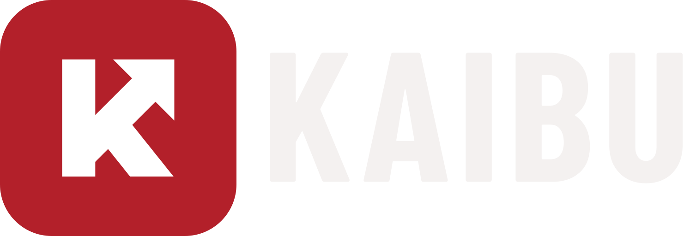
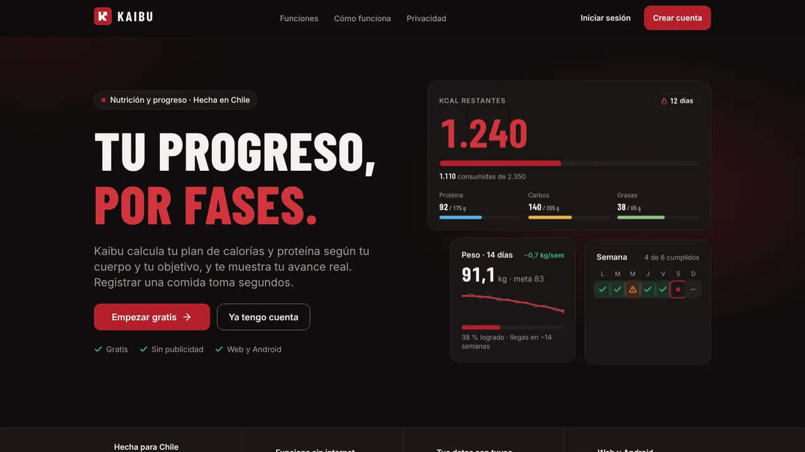
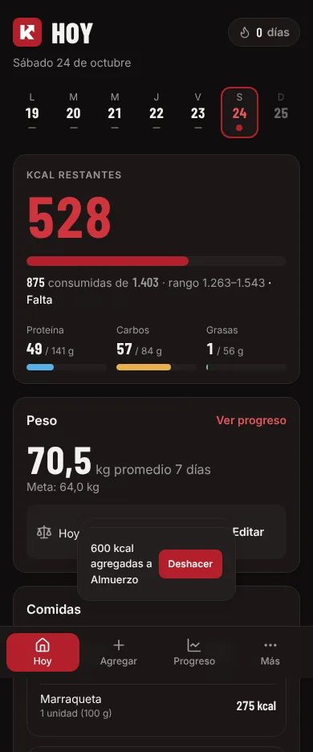
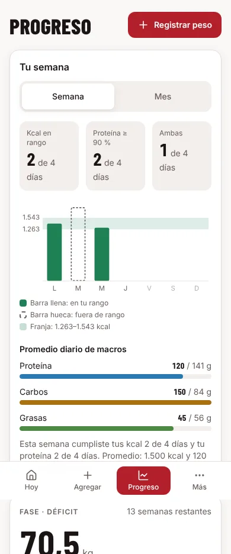
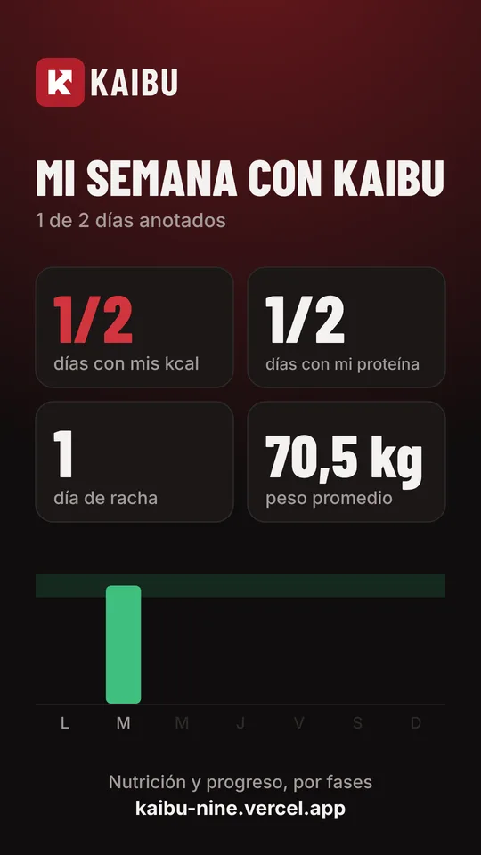
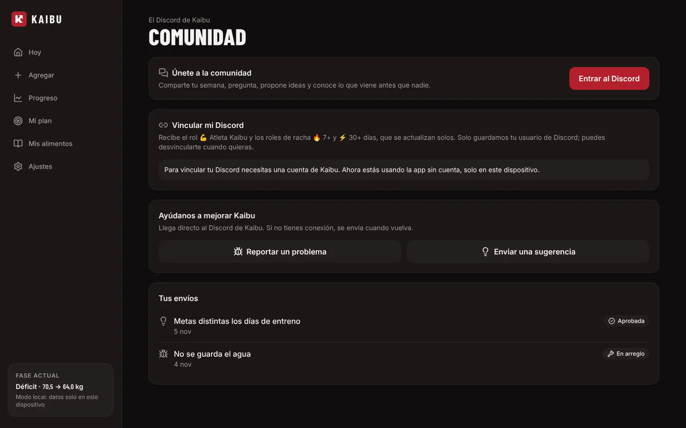
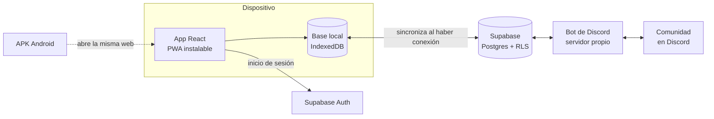

  

<strong>Nutrición y progreso, por fases.</strong> 
Te cobran por que tu plan se adapte a ti. Kaibu lo adapta gratis.

  <a href="https://kaibu-nine.vercel.app">kaibu-nine.vercel.app</a> · Versión <strong>0.2.0-beta</strong> · Hecha en Chile 🇨🇱

## Qué es Kaibu

Kaibu es una app para anotar lo que comes y ver tu progreso real, pensada para la mesa chilena. Calcula tu plan de calorías y proteína según tu cuerpo y tu objetivo (bajar, mantener o subir), te explica cada número y lo **ajusta gratis cada semana** con tu promedio real de 7 días, algo que otras apps cobran.

| Hoy | Tu semana | Compartir |
| :---: | :---: | :---: |
|  |  |  |

## Lo que hace hoy

- **Plan por fases:** kcal, proteína, carbos, grasas y agua calculados y explicados (Mifflin-St Jeor + ISSN), con ajuste semanal y avisos de seguridad.
- **Registro en segundos:** 583 alimentos genéricos (cazuela, pastel de choclo, completo, sopaipillas…) y 4.225 productos con marca de Chile, recientes, favoritos, agregar rápido y copiar ayer.
- **Hábitos:** agua y nota del día, terminar el día con celebraciones y racha.
- **Progreso:** peso con promedio de 7 días y ritmo real, Tu semana y Tu mes, y una imagen para compartir en historias (el peso solo aparece si lo activas).
- **Comunidad:** Discord oficial con bot propio, vincular la cuenta para tener roles por racha, y reportes y sugerencias enviados desde la app.
- **Tus datos son tuyos:** descarga en JSON o Excel, borrar la cuenta en un toque, sin publicidad.
- **Funciona sin internet** y se sincroniza al volver la conexión. Web instalable y Android.

## Cómo está construido

- **Primero el dispositivo:** la app lee y escribe en una base local, por eso responde al instante y funciona sin señal; la nube se pone al día sola.
- **Seguridad en la base de datos:** cada tabla tiene reglas por fila (RLS): cada persona solo puede leer y escribir lo suyo, verificado con pruebas automáticas.
- **Cálculos como funciones puras** con pruebas: el mismo resultado en la app, en el bot y en la documentación.
- **Accesible:** contraste AA, navegación con teclado y lector de pantalla, sin depender solo del color; revisado con axe en cada prueba de pantalla.

**Tecnologías:** React · TypeScript estricto · Vite · Tailwind CSS · Radix · Motion · Dexie · TanStack Query · Supabase · discord.js · Remotion (videos) · Vitest y Playwright.

## Calidad

| | |
| --- | --- |
| Pruebas de cálculos y datos | 191 (Vitest) |
| Pruebas de pantalla | 72 en celular y PC, tema claro y oscuro, con revisión de accesibilidad |
| Seguridad de la base de datos | Prueba de RLS en cada cambio de esquema |
| Bot de Discord | 23 pruebas propias |

## Hoja de ruta

| Etapa | Qué trae | Estado |
| --- | --- | --- |
| 1 · Base y núcleo | Plan, registro, peso, sin conexión | ✅ |
| 2 · Progreso y hábitos | Ajuste semanal, agua, Tu semana, compartir, comunidad · suplementos, fotos privadas, gym, recetas | 🚧 en curso (beta 0.2.0) |
| 3 · Escáner y comunidad | Código de barras, sellos ALTO EN, micronutrientes, base comunitaria | Próxima |
| 4 · IA y tiendas | Google Play y App Store, Kaibu+ con IA, plan para gimnasios y nutricionistas | Después |

## Datos de alimentos

Tabla de composición chilena (INTA, U. de Chile, MINSAL), USDA FoodData Central (dominio público) y Open Food Facts (productos con marca, licencia ODbL). Atribuciones completas en la app, en Licencias de terceros.

## Derechos

© 2026 Francisco Carrera. **Todos los derechos reservados.** Este repositorio se muestra como portafolio del proyecto: no se concede permiso para copiar, modificar, distribuir ni desplegar el código ni la marca Kaibu. Las bibliotecas de terceros mantienen sus propias licencias, y la lista de productos derivada de Open Food Facts se rige por la licencia ODbL. Ver [LICENSE](LICENSE).

¿Quieres probar la beta o colaborar? Escribe a franciscocarrera956@gmail.com.
