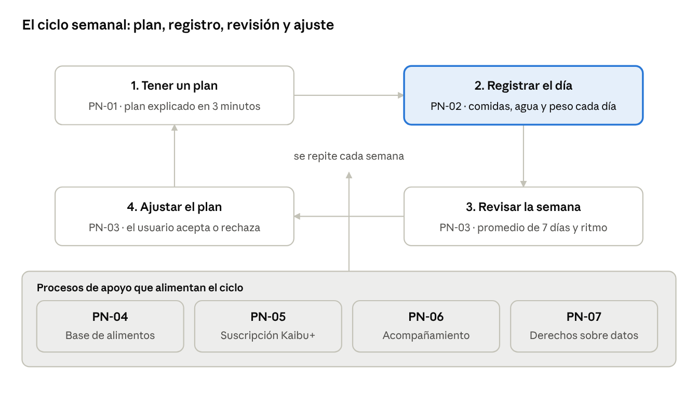
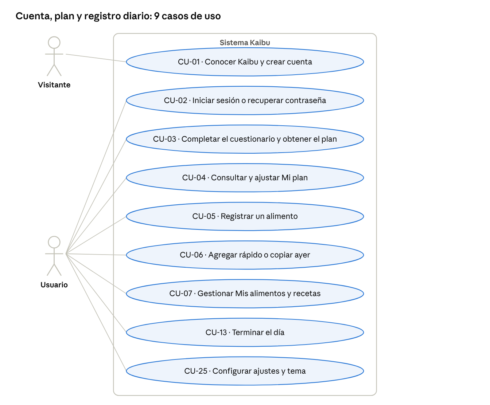
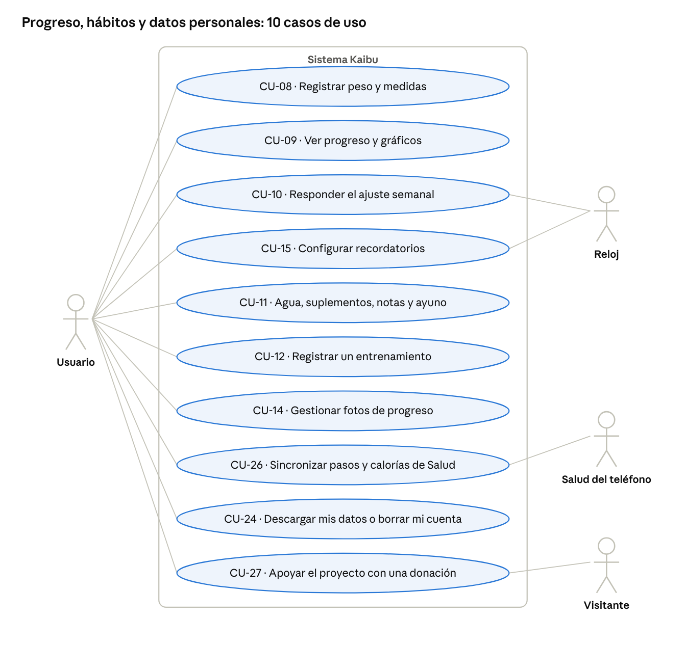
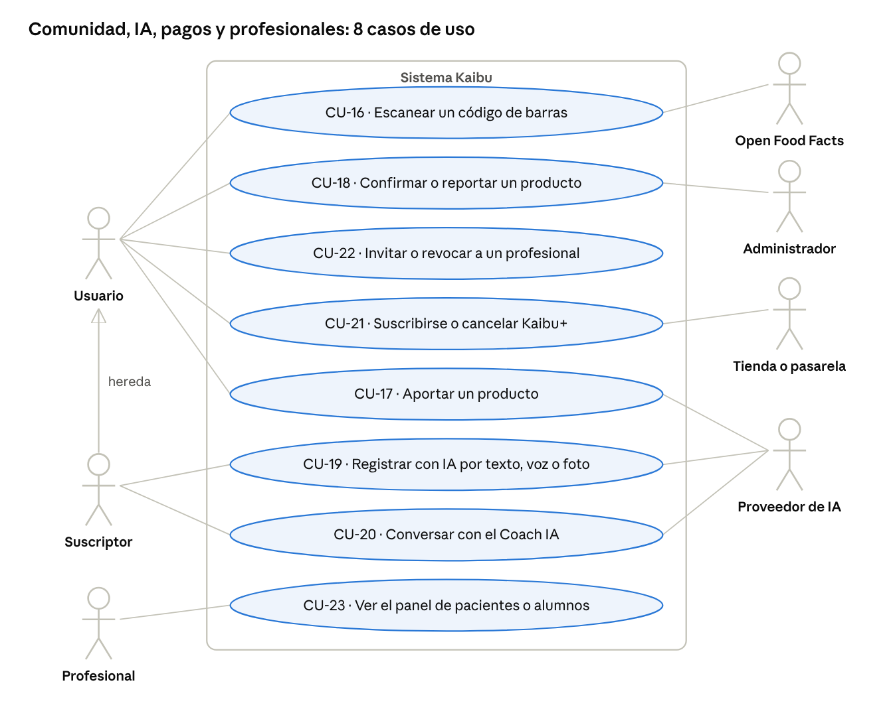
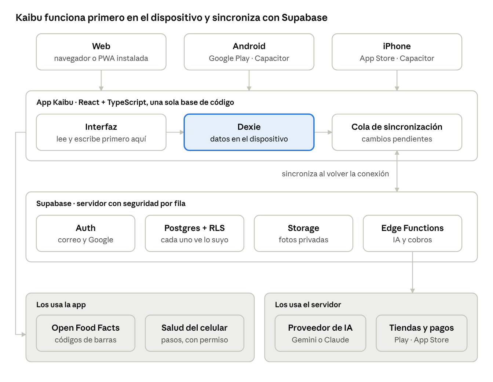

# Kaibu · Especificación de Requisitos de Software (SRS) · versión 2.2

28-10-2026 · Francisco Carrera (Sxnr)

Esta SRS es el plano de Kaibu: define qué deberá hacer la app en web, Android e iPhone, para quién, con qué calidad y cómo se entregará por sprints. Cada requisito tiene un código único, un criterio de aceptación verificable y su origen; lo que no esté en este documento no se construye sin una nueva versión aprobada.

## Control del documento

Versión 2.2, en revisión por el dueño del producto; reemplaza a la versión 2.1 del mismo día.

| Campo | Valor |
| --- | --- |
| Producto | Kaibu: nutrición y progreso, por fases |
| Dueño del producto | Francisco Carrera (Sxnr) |
| Repositorio del código | [github.com/Sxnr/Kaibu](https://github.com/Sxnr/Kaibu), rama `main` |
| Estado | Borrador para aprobación |
| Norma de referencia | ISO/IEC/IEEE 29148 (requisitos) e ISO/IEC 25010 (calidad), adaptadas |

| Versión | Fecha | Cambios |
| --- | --- | --- |
| 1.0 | 28-10-2026 | Primera especificación: requisitos, cálculos, datos, modelo freemium y punto de equilibrio |
| 2.0 | 28-10-2026 | Estructura formal completa: alcance, objetivos, dominio, necesidades y objetivos del negocio, procesos, casos de uso, criterios de aceptación, iPhone como plataforma, plan Scrum con MVP, trazabilidad y fuentes chilenas e internacionales confirmadas. Precio de Kaibu+ ajustado a la competencia chilena |
| 2.1 | 28-10-2026 | Comentarios de ProductIA (Soho): el dolor del usuario primero (4.0), mercado y expansión por etapas con el gimnasio como primer grupo (4.7), costos para mantener la app sin sueldos (15), validación de pago en la beta (ON-09), lectura de calorías desde Salud (RF-58) e investigación de la IA de Apple en iPhone (RF-66) |
| 2.2 | 28-10-2026 | Todas las fuentes abiertas y verificadas (OMS 2024, StatCounter de 12 meses, precios reales de la App Store de Chile). Estudio de competencia con 10 apps (4.6). Nuevo gancho: "Te cobran por que tu plan se adapte a ti; Kaibu lo adapta gratis". Plan de lanzamiento y promoción en TikTok e Instagram (19) y lista de espera (RF-67) |

**Aprobación.** Esta versión queda aprobada cuando el dueño del producto lo indica por escrito (comentario en este documento o mensaje). Desde la aprobación, todo cambio de alcance requiere una nueva versión con su fila en la tabla de cambios.

## 1. Introducción

### 1.1 Propósito

Este documento captura todos los requisitos que Kaibu deberá cumplir antes de construir las etapas 2 a 4. Es la base para estimar, planificar los sprints, probar cada entrega y aceptar el producto.

### 1.2 Audiencia

| Lector | Qué secciones le sirven |
| --- | --- |
| Dueño del producto | Todas; aprueba el documento |
| Socios e inversionistas | 2, 3, 4, 5, 6, 15 y 16 |
| Nutricionistas y gimnasios | 4, 8, 12 y 15 |
| Equipo de desarrollo y pruebas | 9 a 14, 16 y 18 |

### 1.3 Reglas de redacción (para que no haya ambigüedades)

1. **"Deberá"** indica un requisito obligatorio; **"podrá"** indica algo opcional que el usuario puede usar o no. No se usan "debería", "rápido", "fácil", "amigable" ni "etc." en un requisito.
2. Cada requisito expresa **una sola** capacidad, tiene un **código único** que no se reutiliza y un **criterio de aceptación** que se puede comprobar con una prueba (sí o no, o un número).
3. **Prioridad MoSCoW:** M = imprescindible para su etapa; S = importante, puede pasar al sprint siguiente; C = deseable si hay tiempo; W = fuera de esta versión.
4. **Acceso:** Gratis (siempre), Kaibu+ (membresía) o Profesional (plan para nutricionistas y gimnasios).
5. **Estado:** Hecho (en `main` y probado), Parcial (una parte hecha, se indica cuál) o Pendiente.
6. Los números usan formato chileno (coma decimal, punto de miles) y pesos chilenos (CLP) salvo que diga US$.

| Prefijo | Significa |
| --- | --- |
| OP / ON | Objetivo del proyecto / objetivo del negocio |
| NN | Necesidad del negocio |
| PN | Proceso del negocio |
| CUN / CU | Caso de uso del negocio / caso de uso del sistema |
| RF / RNF | Requisito funcional / no funcional |
| RN | Regla de negocio o de cálculo |
| RD | Requisito de datos |

### 1.4 Referencias

El documento de requisitos original del dueño (secciones 1 a 16), el código en `main` y las fuentes del Anexo A. Las cifras de terceros se marcan con su fuente y su fecha.

## 2. Alcance del proyecto

Kaibu es una sola aplicación (un solo código) para PC, celulares Android e iPhone, con una cuenta y datos sincronizados entre todos. Calcula un plan nutricional, registra comidas, peso y hábitos, y muestra el progreso. El mercado inicial es Chile, en español.

### 2.1 Plataformas

| Plataforma | Cómo llega al usuario | Desde |
| --- | --- | --- |
| Web en PC (Chrome, Edge, Firefox, Safari; 2 últimas versiones) | Sitio web publicado | Etapa 1 (MVP) |
| Web en celular Android e iPhone | El mismo sitio, instalable en la pantalla de inicio (PWA) | Etapa 1 (MVP) |
| App Android (versión 8.0 o superior) | Google Play, empaquetada con Capacitor | Etapa 4 |
| App iPhone (iOS 16.4 o superior) | App Store, empaquetada con Capacitor | Etapa 4 |

### 2.2 Dentro del alcance

| Etapa | Qué entrega |
| --- | --- |
| 1 · Base y núcleo (hecha) | Cuenta, consentimientos, cuestionario, plan explicado, registro de comidas, catálogo chileno, peso, Mi plan, sin conexión, landing y video demo |
| 2 · Progreso y hábitos | Gráficos, fotos privadas, medidas, agua, suplementos, notas, racha y "Terminar día", recordatorios, gym, recetas, ayuno, exportar y borrar cuenta, legal |
| 3 · Escáner y comunidad | Código de barras, Open Food Facts, base comunitaria chilena con verificación y sellos "ALTO EN" |
| 4 · IA y apps nativas | Registro por texto, voz y foto; Coach IA; apps en Google Play y App Store; pasos (Health Connect y HealthKit); Kaibu+ y plan Profesional |

### 2.3 Fuera del alcance

- Diagnosticar, tratar o prescribir: Kaibu entrega estimaciones y no reemplaza a un nutricionista ni a un médico.
- Planes de dieta cerrados (menús obligatorios) y venta de alimentos o suplementos.
- Publicidad dentro de la app y venta de datos a terceros.
- Apps para reloj (Apple Watch, Wear OS), tablets con diseño propio y otros idiomas en esta versión.
- Usuarios menores de 14 años.

### 2.4 Entregables del proyecto

1. Esta SRS aprobada y versionada.
2. Por cada sprint: la app funcionando en la web publicada, el código en `main`, las pruebas en verde y una nota de entrega con qué se hizo y cómo probarlo.
3. Al cierre de la Etapa 4: fichas publicadas en Google Play y App Store.
4. Todo el código fuente, la base de datos (migraciones), los diseños y los documentos pertenecen al dueño y quedan en su repositorio.

## 3. Objetivos del proyecto

El proyecto termina cuando Kaibu está en web, Google Play y App Store con las 4 etapas, en 10 sprints de 2 semanas contados desde la aprobación de esta SRS. Cada objetivo tiene una medida y un plazo.

| Código | Objetivo | Cómo se mide | Plazo |
| --- | --- | --- | --- |
| OP-01 | Publicar el MVP en la web y abrir una beta privada | Sitio público con HTTPS y al menos 20 personas invitadas usando la app | Fin del Sprint 2 |
| OP-02 | Completar la Etapa 2 (progreso y hábitos) | Todos sus RF con prioridad M en estado Hecho | Fin del Sprint 4 |
| OP-03 | Completar la Etapa 3 (escáner y comunidad) | Todos sus RF M en estado Hecho | Fin del Sprint 6 |
| OP-04 | Completar la Etapa 4 y publicar en Google Play y App Store | Ambas fichas aprobadas por las tiendas | Fin del Sprint 10 |
| OP-05 | Registrar una comida frecuente en 10 segundos o menos | Prueba con 5 personas: mediana ≤ 10 s y ≤ 3 toques desde Hoy | Fin del Sprint 2 |
| OP-06 | Mantener la calidad en cada entrega | 100 % de las pruebas automáticas en verde, 0 errores de accesibilidad (axe) y Lighthouse ≥ 90 en las 4 categorías | Cada sprint |
| OP-07 | Cumplir la Ley 21.719 antes de abrir al público | Lista de cumplimiento de la sección 11 al 100 % y revisión de un abogado | Antes del lanzamiento público |
| OP-08 | Operar con bajo costo hasta tener ingresos | Gasto mensual en servicios ≤ $60.000 | Hasta el primer mes con ingresos |

## 4. Introducción al dominio del problema

En Chile, 3 de cada 4 personas mayores de 15 años tienen sobrepeso u obesidad, y el cálculo que orienta una alimentación equilibrada es público desde 1990. Algunas apps ya entregan gratis la meta inicial, pero cobran por lo que hace que el plan funcione: que se ajuste con el progreso real y que anotar sea rápido. Kaibu entrega gratis el plan y su ajuste semanal, muestra de dónde sale cada número y está hecha para la mesa chilena. Las cifras de esta sección tienen su fuente en el Anexo A.

### 4.0 El dolor del usuario

Kaibu parte desde el dolor de una persona concreta, no desde la tecnología. El primer grupo al que apunta es quien va al gimnasio y quiere bajar o subir de peso (sección 4.7). Este es su recorrido típico sin Kaibu (usuario ilustrativo, no una persona real):

1. **Quiere resultados y no sabe cuánto comer.** Tres calculadoras le dan tres números distintos y ninguna explica de dónde salen.
2. **Le cobran por lo que hace funcionar el plan.** La meta inicial ya es gratis en algunas apps, pero que el plan se ajuste a su progreso real cuesta hasta $61.900 al año, y anotar con una foto, entre $19.990 y $69.990 al año (App Store Chile, octubre de 2026).
3. **Registrar le toma demasiado.** La marraqueta, la once o el completo no aparecen o aparecen mal, y anotar el día completo toma varios minutos.
4. **El peso lo desanima.** Se pesa, sube 600 g por agua o sodio y concluye que no funciona.
5. **Abandona.** En apps de salud solo cerca de 18 % sigue usando la app al día 7 (Anexo A).

| Código | Dolor | Qué lo resuelve en Kaibu | Acceso |
| --- | --- | --- | --- |
| D-01 | No sabe cuánto comer ni confía en el número | Plan calculado y explicado línea por línea (RF-07, RF-08) | Gratis |
| D-02 | Le cobran por que el plan se adapte a su progreso | Ajuste semanal con su promedio real, explicado y gratis para siempre (RF-10, RN-11, RN-17) | Gratis |
| D-03 | Registrar toma demasiado tiempo | Catálogo chileno, recientes, copiar ayer y agregar rápido (RF-16 a RF-20); registro por texto, voz o foto con IA (RF-52, RF-53) | Gratis; la IA es Kaibu+ |
| D-04 | El peso diario lo confunde y lo desanima | Promedio de 7 días, ritmo real y ajuste semanal (RF-10, RF-30 a RF-32) | Gratis |
| D-05 | Entre consultas con su nutricionista o entrenador está solo | Resumen semanal compartido con su profesional (RF-63, RF-64) | Profesional |

**El gancho y el dolor que se paga no son lo mismo.** El gancho es D-02: *"Te cobran por que tu plan se adapte a ti. Kaibu lo adapta gratis."* Atrae porque es verdad y porque nadie paga por dejar de pagar. Lo que se paga es ahorrar tiempo al anotar (D-03 con IA) y tener acompañamiento (D-05). Por eso lo gratis es amplio y lo pago se limita a esas dos cosas. Esta hipótesis se valida en la beta con el objetivo ON-09.

### 4.1 El problema de salud

| Dato | Valor | Fuente |
| --- | --- | --- |
| Chile: sobrepeso, obesidad y obesidad mórbida (mayores de 15 años) | 74,2 % (39,8 % sobrepeso, 31,2 % obesidad y 3,2 % obesidad mórbida) | MINSAL, Encuesta Nacional de Salud 2016-2017 (muestra de 6.233 personas) |
| Mundo: adultos con sobrepeso (2024) | 2.600 millones (45 % de los adultos) | OMS, nota descriptiva del 7 de octubre de 2026 |
| Mundo: adultos con obesidad (2024), incluidos en la cifra anterior | 940 millones (16 % de los adultos) | OMS |
| Causa principal según la OMS | Desbalance entre calorías consumidas y gastadas | OMS |

### 4.2 La ciencia del cálculo

- **Gasto en reposo.** La fórmula Mifflin-St Jeor (Am J Clin Nutr, 1990) se obtuvo midiendo a 498 personas sanas de 19 a 78 años (247 mujeres y 251 hombres), con un ajuste R² = 0,71. El mismo estudio mostró que la fórmula anterior (Harris-Benedict, 1919) sobrestimaba el gasto en 5 %.
- **Por qué esa fórmula.** Una revisión sistemática de la Asociación Americana de Dietética (Frankenfield, 2005) concluyó que Mifflin-St Jeor acierta dentro de ±10 % en más personas que las otras ecuaciones usadas en clínica, pero con errores individuales. Por eso Kaibu corrige la meta con el peso real de cada semana (regla RN-11).
- **Proteína.** La Sociedad Internacional de Nutrición Deportiva (ISSN, 2017) indica 1,4 a 2,0 g por kg al día para la mayoría de las personas que entrenan, y 2,3 a 3,1 g/kg en déficit para quienes entrenan fuerza. Kaibu usa 2,0 g/kg en déficit y 1,8 g/kg en mantención o volumen, editable entre 1,6 y 2,4.

### 4.3 Los alimentos en Chile

- **Composición.** Chile tiene una tabla de composición química de alimentos (Schmidt-Hebbel, Universidad de Chile; edición abierta de 1990) y el MINSAL reportó una actualización en 2010. Cada alimento del catálogo de Kaibu indica su fuente.
- **Etiquetado.** La Ley 20.606 obliga a advertir con sellos "ALTO EN" calorías, azúcares, grasas saturadas y sodio; su reglamento rige desde el 27 de junio de 2016. Kaibu deberá mostrar esos sellos en los productos envasados (RF-39).

### 4.4 Los datos de salud

Peso, alimentación y fotos corporales son **datos sensibles de salud** según la Ley 21.719 de protección de datos personales. Su vigencia legal es el 1 de diciembre de 2026. Un proyecto (boletín 18.623-07) propone postergarla al 1 de diciembre de 2027 y fue aprobado en general por la comisión del Senado el 20 de octubre de 2026, pero aún no es ley. Las multas llegan a 20.000 UTM por tratamiento ilegal de datos sensibles. **Kaibu cumplirá la ley desde su lanzamiento, sin esperar la postergación.**

### 4.5 El celular en Chile

| Dato | Valor | Fuente |
| --- | --- | --- |
| Accesos a internet móvil (junio de 2026) | 22,59 millones; 112,1 por cada 100 habitantes | Subtel |
| Celulares iPhone | Promedio de 19 % entre octubre de 2025 y septiembre de 2026; entre 5,7 % y 33,8 % según el mes; 16 % en septiembre de 2026 | StatCounter, serie mensual |
| Celulares con Android | Promedio de 81 % en el mismo período | StatCounter, serie mensual |

La serie mensual de StatCounter es muy inestable porque su muestra cambia de un mes a otro. Aun con el promedio, **dejar fuera a iPhone excluiría cerca de 1 de cada 5 usuarios**, por eso iPhone es plataforma obligatoria.

### 4.6 Mercado y competencia

Diez apps compiten por el mismo usuario en Chile. La tabla usa los precios que muestra la sección "Compras dentro de la app" de cada ficha de la App Store de Chile el 28 de octubre de 2026; hay varios precios por app porque cambian según la oferta o la fecha de compra. Las calificaciones en Chile indican cuánta gente la usa aquí.

| App | Calificaciones en App Store Chile | Plan pago (CLP) | Qué da gratis | Qué cobra |
| --- | --- | --- | --- | --- |
| Fitia | 31 mil; #2 en Salud y fitness | $4.200 al mes; $22.490 a $24.900 al año | Meta de calorías y macros, registro de hasta 4 comidas y escáner | Plan de comidas, Fitia Coach que adapta el plan, registro con foto y voz |
| MyFitnessPal | 15,7 mil | $6.500 a $14.500 al mes; $32.900 a $57.900 al año | Registro con anuncios | Metas de macros a medida, escáner, registro con foto |
| Yazio | 11,6 mil | $9.900 a $22.900 | Registro básico | Yazio PRO (detalle no verificado) |
| BitePal | 11 mil; #1 en Salud y fitness | $3.990 a $4.990 a la semana; $19.990 a $69.990 al año | No verificado | Registro con foto e IA |
| Cal AI | 5,7 mil | $8.700 a $9.990 al mes; $29.990 a $34.990 al año | No verificado | Registro con foto e IA |
| Welmi | 4,4 mil | $4.690 a $9.000 al mes; $27.990 a $37.490 al año | No verificado | Registro con foto o voz e IA |
| Lifesum | 2,8 mil | $6.500 a $8.700 al mes; $35.900 al año | No verificado | Lifesum Premium |
| fatsecret | 2,3 mil | $6.290 a $8.990 al mes; $28.000 al año | Registro, escáner y sincronización con Salud | Premium |
| MacroFactor | 42 | $8.700 a $10.500 al mes; $61.900 al año | Prueba gratis | Plan que se adapta a tu metabolismo cada semana |
| **Kaibu** | — | **$0 lo básico; Kaibu+ $2.490 al mes o $19.990 al año** | **Plan explicado, ajuste semanal, registro ilimitado, gym, progreso y escáner** | **Solo la IA (Kaibu+) y el panel Profesional** |

"No verificado" significa que no se revisó dentro de la app; no se afirma que no lo tenga. Lo gratis de Fitia viene de su centro de ayuda; lo de MyFitnessPal, de reseñas de 2026.

**Lo que la competencia hace mejor hoy.** Fitia tiene más de 10 millones de usuarios, comidas latinoamericanas, IA con foto y voz y un coach. Las apps de foto (BitePal, Cal AI, Welmi) resuelven "anotar rápido" en segundos y crecen rápido. Kaibu no compite con ellas en IA, sino en lo que da gratis.

**Dónde gana Kaibu.**

1. **El ajuste semanal es gratis y se explica** (RN-11). Otras apps lo cobran: hasta $61.900 al año.
2. **Nutrición y gym en una sola app** (RF-37), con progresión de cargas.
3. **Hecha para Chile:** sellos ALTO EN de la Ley 20.606 (RF-39), marraqueta y once, formato chileno.
4. **Panel para nutricionistas y gimnasios** a $14.990 al mes, más barato que el software para nutricionistas (Nutrium: €24 a €40 al mes).
5. **Sin anuncios**, y los datos de salud se tratan según la Ley 21.719.
6. **Kaibu+ es el más barato:** $2.490 al mes, frente a $4.200 de Fitia y más de $6.000 del resto.

**Señales del mercado.**

- En Latinoamérica, Fitia estuvo entre las 5 apps de salud y fitness con más ingresos a fines de 2025: unos US$60 mil a la semana (unos US$3 millones al año), cerca de 800 mil usuarios activos y unas 105 mil descargas semanales (Sensor Tower). **En la región sí se paga por apps de nutrición.**
- La foto con IA es lo que más se paga: Cal AI habría facturado cerca de US$35 millones en 2025 (Latka, fuente secundaria).
- El mercado mundial de apps de dieta y nutrición crecería 17,2 % al año hasta US$938,6 millones en 2030 (Grand View Research); otras consultoras lo estiman mayor porque lo definen distinto.

### 4.7 Mercado y expansión por etapas

Kaibu no apunta a todos desde el primer día: parte por el grupo que más siente el dolor y que ya paga apps, y se expande cuando ese grupo está bien servido. Las cifras son órdenes de magnitud para decidir, no un pronóstico.

| Dato de Chile | Valor | Fuente |
| --- | --- | --- |
| Población (junio de 2026) | 20,15 millones | INE, proyección base 2024 |
| Personas de 15 años o más | Cerca de 16,9 millones (los menores de 15 son 16,3 %) | Calculado desde el INE |
| Declara hacer actividad física | 58 % | Radiografía del Deporte 2025 (Cadem y SPARTA) |
| Gimnasio entre las disciplinas | 21 % (la fuente no precisa si es del total o de quienes hacen deporte); 31 % entrena en un gimnasio | Radiografía del Deporte 2025 |
| Sobrepeso u obesidad (mayores de 15 años) | 74,2 % | ENS 2016-2017 |
| Gimnasios | Cerca de 2.000 locales; crecieron 72 % entre 2020 y 2025. Smart Fit tiene 117 sedes y unos 300 mil clientes (2024) | La Tercera (XBrein), Chócale |

| Etapa de público | Quiénes | Tamaño aproximado | Qué necesita de Kaibu | Desde |
| --- | --- | --- | --- | --- |
| 1. Primer grupo | Personas que van al gimnasio y quieren bajar o subir de peso | Entre 2,0 y 3,5 millones de personas de 15 años o más van al gimnasio (12 % a 21 % de 16,9 millones); se desconoce cuántas buscan cambiar su peso | Plan, macros, ajuste semanal, registro rápido, progreso y gym | MVP (Sprint 2) |
| 2. Expansión | Personas que quieren comer mejor o bajar de peso sin entrenar | La mayor parte de los cerca de 12,5 millones con sobrepeso u obesidad | Registro aún más simple (escáner e IA), recordatorios y sellos ALTO EN | Etapa 3 (Sprints 5 y 6) |
| 3. Canal profesional | Nutricionistas, entrenadores y gimnasios | Cerca de 2.000 gimnasios; el número de nutricionistas se medirá en el Registro de Prestadores de la Superintendencia de Salud | Panel profesional; traen a sus pacientes y alumnos. Rivales: Nutrium (€24 a €40 al mes) y Dietbox (170 mil profesionales, en expansión a Chile) | Etapa 4 (Sprint 10) |

**Lo que significa.** La meta del primer año (ON-01: 1.000 usuarios activos al mes) es menos de 0,1 % del primer grupo: el riesgo no es el tamaño del mercado, sino retener (ON-02) y que una parte pague (ON-03, ON-09). Si el primer grupo no paga lo suficiente, la expansión al segundo grupo y al canal profesional amplía la base antes de invertir más.

### 4.8 Qué implica para los requisitos

1. El plan y su explicación deben ser gratis y claros: es la propuesta de valor (RF-07, RF-08).
2. El cálculo debe corregirse con datos reales del usuario, porque la fórmula tiene error individual (RN-11).
3. Los datos de salud exigen consentimiento explícito, privacidad y borrado (RNF de privacidad).
4. Deben cubrirse web, Android e iPhone.

## 5. Necesidades del negocio

Kaibu necesita diferenciarse dando gratis lo básico y, a la vez, generar ingresos con lo avanzado; todo lo demás se desprende de esas dos necesidades.

| Código | Necesidad | Por qué existe |
| --- | --- | --- |
| NN-01 | Ofrecer gratis y para siempre el cálculo, su explicación, el ajuste semanal y el registro básico | Es la propuesta de valor frente a apps que cobran por adaptar el plan (sección 4.6) |
| NN-02 | Generar ingresos que cubran los costos y devuelvan la inversión | Sin ingresos el producto no se sostiene (sección 15) |
| NN-03 | Llegar a todos los usuarios de celular en Chile y a PC | Cerca de 19 % usa iPhone (promedio de 12 meses) y el resto Android (sección 4.5) |
| NN-04 | Cumplir la ley chilena de datos sensibles y de etiquetado | Ley 21.719 y Ley 20.606 (sección 4.3 y 4.4) |
| NN-05 | Retener a los usuarios en el tiempo | Las apps de salud retienen en promedio cerca de 18 % al día 7 (Anexo A) |
| NN-06 | Ser la opción hecha para Chile | Alimentos, comidas y formato chilenos con fuente |
| NN-07 | Tener credibilidad científica | Cada número con su fórmula y su fuente (sección 4.2) |
| NN-08 | Validar el mercado antes de invertir más | Retención y conversión reales deciden la inversión (sección 15) |
| NN-09 | Abrir un canal con nutricionistas y gimnasios | Segunda fuente de ingresos y de usuarios |
| NN-10 | Operar con bajo costo al inicio | No hay ingresos hasta la Etapa 4 |

## 6. Objetivos del negocio

El negocio es viable si a 6 meses de lanzar Kaibu+ los ingresos cubren los costos de servicios, con al menos 55 suscriptores o su equivalente en profesionales. Las metas son propuestas y deben confirmarse con los datos de la beta.

| Código | Objetivo | Indicador | Meta | Plazo | Necesidad |
| --- | --- | --- | --- | --- | --- |
| ON-01 | Ganar el primer grupo (gimnasio) | Usuarios activos en el mes que entrenan | 1.000 | 6 meses desde el lanzamiento público | NN-03, NN-06 |
| ON-02 | Retener mejor que el promedio | Retención al día 7 | ≥ 25 % (promedio de salud: 18 %) | Durante la beta | NN-05 |
| ON-03 | Convertir a pago | Suscriptores Kaibu+ / usuarios activos | ≥ 2 % | 6 meses desde que existe Kaibu+ | NN-02 |
| ON-04 | Cubrir el costo de mantener la app | Ingresos netos ≥ costo del nivel Estable (sección 15.4) | ≥ 55 suscriptores o 5 profesionales | 6 meses desde que existe Kaibu+ | NN-02, NN-10 |
| ON-05 | Abrir el canal profesional | Profesionales pagando | ≥ 10 | 12 meses desde que existe el plan | NN-09 |
| ON-06 | Ganar confianza | Nota en Google Play y App Store | ≥ 4,5 de 5 | 6 meses desde la publicación | NN-06, NN-07 |
| ON-07 | Proteger los datos | Incidentes de seguridad con datos personales | 0 | Siempre | NN-04 |
| ON-08 | Mantener lo básico gratis | Funciones del plan Gratis que pasan a pago | 0 | Siempre | NN-01 |
| ON-09 | Validar que la gente pagaría | Encuesta a los usuarios activos de la beta y lista de espera de Kaibu+ | ≥ 30 % responde que pagaría $2.490 al mes y ≥ 100 personas se inscriben en la lista de espera | Fin del Sprint 4 | NN-02, NN-08 |
| ON-10 | Expandir al segundo grupo | Usuarios activos que no entrenan / usuarios activos | ≥ 30 % | 12 meses desde el lanzamiento público | NN-03, NN-06 |

## 7. Descripción de los procesos del negocio

El corazón de Kaibu es un ciclo de cuatro pasos que se repite cada semana: tener un plan, registrar el día, revisar la semana y ajustar el plan con datos reales.

### 7.1 Situación actual (sin Kaibu)

1. La persona busca una calculadora en internet o paga una app para saber cuánto comer; el resultado no se explica.
2. Anota lo que come en una app extranjera sin alimentos chilenos, o en un cuaderno, o no lo anota.
3. Se pesa de forma irregular y compara pesos sueltos, que varían día a día por agua y sodio.
4. Si va a un nutricionista (entre $20.000 y $40.000 por consulta), entre una consulta y otra no hay seguimiento.

**Problemas:** costo por lo básico, números sin explicación, registro lento, conclusiones erróneas por mirar pesos sueltos y nada de seguimiento entre consultas.

### 7.2 Situación propuesta (con Kaibu)

&#91;embedded content: ciclo de procesos · 4 pasos semanales y 4 procesos de apoyo\]



Registrar el día es el paso que más se repite y el que más cuida el diseño; los procesos de apoyo mejoran los datos, financian el producto y protegen al usuario.

| Código | Proceso | Quién participa | Pasos | Resultado |
| --- | --- | --- | --- | --- |
| PN-01 | Alta y plan | Visitante, Kaibu | 1. Conoce Kaibu en la landing. 2. Crea su cuenta y acepta los consentimientos. 3. Responde el cuestionario. 4. Recibe su plan explicado | Plan personal en menos de 3 minutos |
| PN-02 | Registro diario | Usuario | 1. Registra comidas, agua y peso. 2. Ve sus kcal y macros restantes. 3. Termina el día | Día cumplido o no; la racha se actualiza |
| PN-03 | Revisión y ajuste semanal | Usuario, Kaibu | 1. Kaibu calcula el promedio de 7 días y el ritmo real. 2. Si corresponde, sugiere un ajuste de kcal. 3. El usuario acepta o rechaza | Plan corregido con datos reales |
| PN-04 | Mejora de la base de alimentos | Usuarios, Kaibu | 1. Escanea un producto. 2. Si no existe, lo aporta con fotos. 3. Otros usuarios lo confirman | Producto verificado disponible para todos |
| PN-05 | Suscripción Kaibu+ | Usuario, tienda o pasarela de pago | 1. Prueba la IA gratis. 2. Se suscribe. 3. Renueva o cancela en un toque | Ingreso recurrente |
| PN-06 | Acompañamiento profesional | Usuario, nutricionista o gimnasio | 1. El usuario invita a su profesional. 2. El profesional ve un resumen semanal. 3. El usuario puede revocar el acceso | Seguimiento entre consultas |
| PN-07 | Derechos sobre los datos | Usuario | 1. Descarga sus datos. 2. Los corrige. 3. Borra su cuenta | Cumplimiento de la Ley 21.719 |

## 8. Casos de uso del negocio

Nueve casos de uso describen qué valor obtiene cada actor del negocio; cada uno se apoya en un proceso de la sección 7 y se detalla en casos de uso del sistema (sección 9).

**Actores del negocio:** Persona (cualquier adulto que quiere comer mejor), Suscriptor (Persona con Kaibu+), Profesional (nutricionista, entrenador o gimnasio), Administrador de Kaibu, Tienda de apps o pasarela de pago y Proveedor de IA.

| Código | Caso de uso del negocio | Actor | Valor que obtiene | Proceso |
| --- | --- | --- | --- | --- |
| CUN-01 | Obtener un plan nutricional explicado sin pagar | Persona | Sabe cuánto comer y por qué | PN-01 |
| CUN-02 | Llevar el control diario de lo que come | Persona | Ve cuánto le queda del día en segundos | PN-02 |
| CUN-03 | Conocer su avance real y ajustar el plan | Persona | Decide con promedios y no con pesos sueltos | PN-03 |
| CUN-04 | Registrar con menos esfuerzo usando IA | Suscriptor | Anota comidas por voz, texto o foto | PN-05 |
| CUN-05 | Aportar productos chilenos | Persona | Encuentra y deja disponibles productos locales | PN-04 |
| CUN-06 | Moderar la base comunitaria | Administrador | Mantiene datos confiables | PN-04 |
| CUN-07 | Seguir a sus pacientes o alumnos entre consultas | Profesional | Acompaña con datos reales y con permiso | PN-06 |
| CUN-08 | Apoyar el proyecto | Persona | Contribuye sin obtener ventajas pagadas | PN-05 |
| CUN-09 | Controlar sus datos personales | Persona | Descarga, corrige o borra todo | PN-07 |

## 9. Casos de uso del sistema

27 casos de uso cubren todo lo que los actores hacen con Kaibu; se agrupan en tres diagramas y los 8 de mayor riesgo se especifican paso a paso.

### 9.1 Actores del sistema

| Actor | Tipo | Descripción |
| --- | --- | --- |
| Visitante | Persona | Entra a la web sin cuenta |
| Usuario | Persona | Tiene cuenta y usó el plan Gratis |
| Suscriptor | Persona | Usuario con Kaibu+ vigente; hereda todo lo del Usuario |
| Profesional | Persona | Nutricionista, entrenador o gimnasio con plan Profesional |
| Administrador | Persona | Equipo de Kaibu que modera la base comunitaria |
| Proveedor de IA | Sistema externo | Gemini o Claude, llamado solo desde el servidor |
| Open Food Facts | Sistema externo | Base abierta de productos con código de barras |
| Tienda o pasarela | Sistema externo | Google Play, App Store o pago web |
| Salud del teléfono | Sistema externo | Health Connect (Android) o HealthKit (iPhone) |
| Reloj | Tiempo | Dispara recordatorios y la revisión semanal |

### 9.2 Catálogo de casos de uso

| Código | Caso de uso | Actor principal | Etapa |
| --- | --- | --- | --- |
| CU-01 | Conocer Kaibu y crear cuenta | Visitante | 1 |
| CU-02 | Iniciar sesión o recuperar contraseña | Usuario | 1 |
| CU-03 | Completar el cuestionario y obtener el plan | Usuario | 1 |
| CU-04 | Consultar y ajustar Mi plan | Usuario | 1 |
| CU-05 | Registrar un alimento | Usuario | 1 |
| CU-06 | Agregar rápido o copiar ayer | Usuario | 1 |
| CU-07 | Gestionar Mis alimentos y recetas | Usuario | 1 y 2 |
| CU-08 | Registrar peso y medidas | Usuario | 1 y 2 |
| CU-09 | Ver progreso y gráficos | Usuario | 1 y 2 |
| CU-10 | Responder el ajuste semanal | Usuario, Reloj | 2 |
| CU-11 | Registrar agua, suplementos, notas y ayuno | Usuario | 2 |
| CU-12 | Registrar un entrenamiento | Usuario | 2 |
| CU-13 | Terminar el día | Usuario | 2 |
| CU-14 | Gestionar fotos de progreso | Usuario | 2 |
| CU-15 | Configurar recordatorios | Usuario, Reloj | 2 |
| CU-16 | Escanear un código de barras | Usuario, Open Food Facts | 3 |
| CU-17 | Aportar un producto | Usuario, Proveedor de IA | 3 |
| CU-18 | Confirmar o reportar un producto | Usuario, Administrador | 3 |
| CU-19 | Registrar con IA por texto, voz o foto | Suscriptor, Proveedor de IA | 4 |
| CU-20 | Conversar con el Coach IA | Suscriptor, Proveedor de IA | 4 |
| CU-21 | Suscribirse o cancelar Kaibu+ | Usuario, Tienda o pasarela | 4 |
| CU-22 | Invitar o revocar a un profesional | Usuario | 4 |
| CU-23 | Ver el panel de pacientes o alumnos | Profesional | 4 |
| CU-24 | Descargar mis datos o borrar mi cuenta | Usuario | 2 |
| CU-25 | Configurar ajustes y tema | Usuario | 1 |
| CU-26 | Sincronizar pasos y calorías de Salud | Usuario, Salud del teléfono | 4 |
| CU-27 | Apoyar el proyecto con una donación | Visitante, Usuario | 2 |

### 9.3 Diagramas de casos de uso

&#91;embedded content: diagrama de casos de uso 1 · cuenta, plan y registro diario\]



El Visitante solo conoce Kaibu y crea su cuenta; desde ahí es Usuario y todo lo de este diagrama es Gratis.

&#91;embedded content: diagrama de casos de uso 2 · progreso, hábitos y datos personales\]



El Reloj dispara el ajuste semanal y los recordatorios; la Salud del teléfono entrega los pasos solo con permiso del usuario.

&#91;embedded content: diagrama de casos de uso 3 · comunidad, IA, pagos y profesionales\]



El Suscriptor hereda todo lo del Usuario y suma la IA; el Proveedor de IA solo se llama desde el servidor.

### 9.4 Especificación de los casos de uso principales

**CU-03 · Completar el cuestionario y obtener el plan**

- **Actor:** Usuario. **Precondición:** tiene cuenta y aceptó ambos consentimientos.
- **Flujo básico:** 1. El sistema muestra una pregunta por pantalla con barra de avance. 2. El usuario responde nombre, sexo, fecha de nacimiento, estatura, peso, actividad, días de entrenamiento, objetivo, peso meta, velocidad y comidas al día. 3. El sistema calcula el plan (RN-01 a RN-09). 4. El sistema muestra "Tu plan" con cada valor y su explicación.
- **Alternos:** 2a. Un dato está fuera de rango: el sistema indica el rango válido y no avanza. 3a. La meta queda bajo el límite de seguridad: el sistema muestra un aviso (RN-12) y el usuario decide.
- **Postcondición:** el perfil y el plan quedan guardados en el dispositivo y en el servidor.

**CU-05 · Registrar un alimento**

- **Actor:** Usuario. **Precondición:** tiene un plan.
- **Flujo básico:** 1. Toca "+" en una comida. 2. Escribe al menos 2 letras. 3. El sistema muestra coincidencias de Mis alimentos, recientes, favoritos y catálogo. 4. Elige uno e indica la cantidad. 5. El sistema calcula kcal y macros y lo guarda. 6. Muestra un aviso con "Deshacer".
- **Alternos:** 3a. Sin coincidencias: ofrece "Agregar rápido" y "Crear alimento". 5a. Sin conexión: guarda en el dispositivo y sincroniza al volver la señal.
- **Postcondición:** el registro suma al día y se actualizan las kcal restantes.

**CU-08 · Registrar peso**

- **Actor:** Usuario. **Flujo básico:** 1. Toca "Registrar peso". 2. Ingresa kilos (30,0 a 300,0) y fecha (no futura; por defecto hoy). 3. El sistema guarda un peso por día y recalcula promedio de 7 días, avance y fecha estimada.
- **Alterno:** 2a. Ya existe un peso ese día: lo reemplaza y ofrece "Deshacer".

**CU-10 · Responder el ajuste semanal**

- **Actores:** Reloj, Usuario. **Disparador:** el domingo, con al menos 2 semanas de pesos.
- **Flujo básico:** 1. El sistema evalúa RN-11. 2. Si corresponde, muestra la sugerencia con su razón. 3. El usuario la acepta o la rechaza. 4. Si acepta, la meta cambia desde el día siguiente.
- **Alterno:** 1a. No corresponde ajuste: no se muestra nada.

**CU-19 · Registrar con IA**

- **Actores:** Suscriptor, Proveedor de IA. **Precondición:** Kaibu+ vigente, conexión a internet y usos del día disponibles.
- **Flujo básico:** 1. Escribe, dicta o fotografía su comida. 2. El servidor envía solo ese contenido al proveedor de IA. 3. El sistema muestra la lista de alimentos con gramos y kcal, editable. 4. El suscriptor confirma y se guarda.
- **Alternos:** 1a. Sin Kaibu+: ofrece la prueba gratis. 1b. Sin usos del día: indica cuándo se renuevan. 2a. Falla la IA: ofrece el registro manual sin perder lo escrito.

**CU-21 · Suscribirse o cancelar Kaibu+**

- **Actores:** Usuario, Tienda o pasarela. **Flujo básico:** 1. Elige plan mensual o anual. 2. Paga en la tienda de su plataforma o en la web. 3. El sistema activa Kaibu+ al recibir la confirmación del pago. 4. Para cancelar, abre "Mi suscripción" y la cancela en un toque; mantiene el acceso hasta el fin del período pagado.
- **Alterno:** 3a. El pago falla: no se activa nada y se informa el motivo.

**CU-22 y CU-23 · Invitar a un profesional y ver el panel**

- **Flujo básico:** 1. El usuario genera una invitación para un profesional. 2. El profesional la acepta. 3. El profesional ve, solo de ese usuario, el resumen semanal (peso promedio, días cumplidos, kcal y proteína promedio). 4. El usuario puede revocar el acceso cuando quiera y el profesional deja de ver datos de inmediato.
- **Regla:** el profesional nunca ve fotos de progreso ni notas del día.

**CU-24 · Descargar mis datos o borrar mi cuenta**

- **Flujo básico (descarga):** 1. En Ajustes → Privacidad, elige "Descargar mis datos". 2. El sistema entrega un archivo JSON y uno CSV con todos sus registros.
- **Flujo básico (borrado):** 1. Elige "Borrar mi cuenta". 2. Escribe la palabra BORRAR para confirmar. 3. El sistema elimina cuenta, registros y fotos del servidor en un máximo de 30 días y cierra la sesión en el dispositivo de inmediato.

## 10. Requisitos funcionales del sistema

67 requisitos funcionales: 26 hechos, 4 parciales y 37 pendientes; 58 son Gratis, 7 son Kaibu+ y 2 son del plan Profesional. "Sprint 0" es la Etapa 1 ya entregada; los códigos se agrupan por tema, no por orden de construcción.

### 10.1 Cuenta, inicio y plan

| Código | El sistema deberá… | Criterio de aceptación | Prior. | Sprint | Estado | Acceso |
| --- | --- | --- | --- | --- | --- | --- |
| RF-01 | Mostrar una landing pública a quien entra sin sesión en la web | Sin sesión se ve la landing en menos de 2 s; con sesión se abre Hoy; en la app nativa nunca se muestra | M | 0 | Hecho | Gratis |
| RF-02 | Mostrar una bienvenida de 3 o 4 pantallas con botón "Saltar" visible en todas | "Saltar" lleva a crear cuenta; se muestra solo la primera vez | M | 0 | Hecho | Gratis |
| RF-03 | Permitir crear cuenta con email y contraseña o con Google, vinculando cuentas del mismo correo | Contraseña de 8 o más caracteres; un mismo correo nunca genera dos cuentas | M | 0 | Hecho | Gratis |
| RF-04 | Permitir recuperar la contraseña por correo | El enlace llega al correo registrado y vence en 1 hora | M | 0 | Hecho | Gratis |
| RF-05 | Pedir dos consentimientos separados y sin marcar: Términos y datos de salud | No se puede crear la cuenta sin ambos; se guarda fecha y versión de cada uno | M | 0 | Hecho | Gratis |
| RF-06 | Guiar un cuestionario de una pregunta por pantalla con barra de avance | Pide los 11 datos de CU-03; no avanza con datos fuera de rango | M | 0 | Hecho | Gratis |
| RF-07 | Mostrar "Tu plan" con kcal, macros, rango, reparto por comida y agua, explicando cada valor | Cada valor tiene una línea con su cálculo; coincide con RN-01 a RN-09 y RN-14 | M | 0 | Hecho | Gratis |
| RF-08 | Mostrar "Mi plan" con mantenimiento, meta, rango, macros, reparto, agua y fase | Los valores se recalculan al cambiar peso promedio o perfil | M | 0 | Hecho | Gratis |
| RF-09 | Permitir ajustar a mano la meta de kcal y los macros | El ajuste manual queda marcado como "ajustado por ti" y puede volver al cálculo | M | 0 | Hecho | Gratis |
| RF-10 | Sugerir el ajuste semanal de RN-11 para que el usuario lo acepte o rechace | Se muestra solo si se cumple RN-11; aceptar cambia la meta desde el día siguiente | M | 1 | Parcial: cálculo hecho | Gratis |
| RF-11 | Mostrar un aviso respetuoso cuando se cumple RN-12, una vez por evento | El aviso no impide continuar; no se repite por la misma causa | M | 1 | Parcial: cálculo hecho | Gratis |
| RF-12 | Proponer el cambio de fase al llegar a la meta (RN-13) | Ofrece mantener o volumen con subida gradual de kcal | S | 1 | Parcial: cálculo hecho | Gratis |

### 10.2 Registro diario

| Código | El sistema deberá… | Criterio de aceptación | Prior. | Sprint | Estado | Acceso |
| --- | --- | --- | --- | --- | --- | --- |
| RF-13 | Mostrar en Hoy kcal restantes, consumidas, meta, rango y barras de proteína, carbos y grasas | Los números cambian en menos de 1 s tras registrar algo | M | 0 | Hecho | Gratis |
| RF-14 | Mostrar la semana de lunes a domingo con el estado de cada día | Cada estado tiene texto o ícono además de color | M | 0 | Hecho | Gratis |
| RF-15 | Mostrar las comidas configuradas (3 o 4 más colaciones) con total y botón "+" | El total de cada comida suma sus registros | M | 0 | Hecho | Gratis |
| RF-16 | Buscar alimentos en Mis alimentos, recientes, favoritos y catálogo | Con 2 letras muestra resultados en menos de 300 ms, también sin conexión | M | 0 | Hecho | Gratis |
| RF-17 | Registrar una cantidad en gramos, porciones o unidades con cálculo automático | kcal y macros = valor por 100 g × gramos ÷ 100, con 1 decimal | M | 0 | Hecho | Gratis |
| RF-18 | Guardar favoritos y mostrar los recientes del usuario | Un registro aparece en recientes de inmediato | M | 0 | Hecho | Gratis |
| RF-19 | Agregar rápido solo kcal y proteína | Se guarda con nombre "Agregado rápido" editable | M | 0 | Hecho | Gratis |
| RF-20 | Copiar una comida o el día completo de ayer | Copia todos los registros con la fecha de hoy y ofrece "Deshacer" | M | 0 | Hecho | Gratis |
| RF-21 | Crear, editar y borrar alimentos propios (privados) | Valida coherencia de kcal según RN-15 | M | 0 | Hecho | Gratis |
| RF-22 | Editar o borrar cualquier registro con aviso inferior y "Deshacer" | "Deshacer" disponible 5 s; nunca se usan ventanas emergentes | M | 0 | Hecho | Gratis |
| RF-23 | Mostrar la racha de días cumplidos (RN-16) | Se actualiza al terminar el día | M | 0 | Hecho | Gratis |
| RF-24 | Permitir "Terminar día" y celebrar una vez: día cumplido, racha, –1 kg y meta | Cada celebración aparece una sola vez por evento y respeta "reducir movimiento" | M | 1 | Pendiente | Gratis |
| RF-25 | Registrar agua con botones + y – y meta diaria (RN-14) | El tamaño del vaso es configurable entre 100 y 1.000 ml | M | 2 | Pendiente | Gratis |
| RF-26 | Gestionar suplementos con dosis y horario, marcarlos como tomados y sumar sus kcal | Un suplemento con kcal se puede agregar a una comida | S | 3 | Pendiente | Gratis |
| RF-27 | Guardar una nota de texto por día | Hasta 1.000 caracteres; editable y borrable | S | 2 | Pendiente | Gratis |
| RF-28 | Personalizar Hoy: mostrar, ocultar y ordenar tarjetas opcionales | La preferencia se guarda por usuario y se sincroniza | C | 4 | Pendiente | Gratis |

### 10.3 Peso y progreso

| Código | El sistema deberá… | Criterio de aceptación | Prior. | Sprint | Estado | Acceso |
| --- | --- | --- | --- | --- | --- | --- |
| RF-29 | Registrar un peso por día entre 30,0 y 300,0 kg con fecha no futura | Un segundo peso el mismo día reemplaza al primero con "Deshacer" | M | 0 | Hecho | Gratis |
| RF-30 | Mostrar la tarjeta de fase: peso inicial, actual (promedio), meta, % logrado y fecha estimada | Coincide con RN-10 y se actualiza al registrar un peso | M | 0 | Hecho | Gratis |
| RF-31 | Comparar el ritmo real con el planeado | Muestra kg por semana con 2 decimales; con menos de 2 semanas de datos explica por qué falta | M | 0 | Hecho | Gratis |
| RF-32 | Graficar el peso diario y el promedio de 7 días con rangos 2 semanas, 1 mes, 3 meses y todo | El promedio es la línea principal en rojo; el gráfico tiene descripción para lector de pantalla | M | 1 | Pendiente | Gratis |
| RF-33 | Mostrar el score semanal (días que cumplió kcal y proteína) y gráficos de kcal y macros por semana y mes | Los totales coinciden con los registros del período | S | 2 | Pendiente | Gratis |
| RF-34 | Subir fotos de progreso privadas, verlas en línea de tiempo y compararlas antes/ahora | Cada foto queda ligada a su fecha y peso; solo su dueño puede verla | S | 3 | Pendiente | Gratis |
| RF-35 | Registrar medidas opcionales: cintura, pecho, brazo y muslo | Valores entre 10 y 250 cm, con fecha | C | 3 | Pendiente | Gratis |

### 10.4 Hábitos, herramientas y datos personales

| Código | El sistema deberá… | Criterio de aceptación | Prior. | Sprint | Estado | Acceso |
| --- | --- | --- | --- | --- | --- | --- |
| RF-36 | Crear, editar, activar y desactivar recordatorios con hora, días y horario de silencio | Ninguno queda activo sin permiso del usuario; no suenan en horario de silencio | M | 3 | Pendiente | Gratis |
| RF-37 | Registrar rutinas propias, series con peso y repeticiones y sugerir progresión (RN-20) | Muestra lo hecho la vez anterior en ese ejercicio | S | 4 | Pendiente | Gratis |
| RF-38 | Crear recetas que se guardan como alimento y generar una lista de compras | La receta calcula kcal y macros por porción | C | 4 | Pendiente | Gratis |
| RF-44 | Ofrecer un temporizador de ayuno opcional, apagado por defecto | Se activa solo desde Ajustes | C | 4 | Pendiente | Gratis |
| RF-45 | Descargar todos los datos del usuario en JSON y CSV | El archivo incluye perfil, registros, pesos, hábitos y consentimientos | M | 2 | Pendiente | Gratis |
| RF-46 | Borrar la cuenta y todos sus datos | Exige escribir BORRAR; borra del servidor en ≤ 30 días y del dispositivo de inmediato | M | 2 | Pendiente | Gratis |
| RF-47 | Generar un informe PDF del progreso | Incluye peso, fase, promedios y cumplimiento del período elegido | C | 4 | Pendiente | Gratis |
| RF-48 | Mostrar Términos, Privacidad, Aviso de salud y Licencias de terceros, con fecha de versión | Al cambiar un documento, el usuario recibe un aviso | M | 2 | Parcial: borradores hechos | Gratis |
| RF-49 | Configurar tema (claro, oscuro, sistema), unidades y comidas del día | El cambio de tema es inmediato y se recuerda por usuario | M | 0 | Hecho | Gratis |
| RF-50 | Borrar los datos de salud del dispositivo al cerrar sesión | Tras cerrar sesión no queda ningún registro en el almacenamiento local | M | 0 | Hecho | Gratis |
| RF-51 | Funcionar sin conexión y sincronizar al volver la señal | Un registro hecho sin red aparece en otro dispositivo ≤ 60 s después de reconectar | M | 0 | Hecho | Gratis |

### 10.5 Escáner y comunidad

| Código | El sistema deberá… | Criterio de aceptación | Prior. | Sprint | Estado | Acceso |
| --- | --- | --- | --- | --- | --- | --- |
| RF-39 | Mostrar la ficha de un producto envasado con sus valores y sellos "ALTO EN" | Muestra cada sello que corresponda según la Ley 20.606, con texto | M | 5 | Pendiente | Gratis |
| RF-40 | Escanear códigos de barras EAN-13 y EAN-8 con la cámara (web, Android e iPhone) | Lee un código en ≤ 3 s con buena luz | M | 5 | Pendiente | Gratis |
| RF-41 | Buscar el código primero en la base de Kaibu y luego en Open Food Facts | Muestra la atribución de Open Food Facts cuando el dato viene de ahí | M | 5 | Pendiente | Gratis |
| RF-42 | Aportar un producto nuevo con foto del frente y de la tabla, que la IA lee para llenar los campos | El usuario revisa y confirma antes de guardar; queda "por verificar" | M | 6 | Pendiente | Gratis con límite (RN-19) |
| RF-43 | Confirmar o reportar productos y pasarlos a "verificado" según RN-18 | Un producto nunca se duplica por código de barras | M | 6 | Pendiente | Gratis |

### 10.6 IA, apps nativas y monetización

| Código | El sistema deberá… | Criterio de aceptación | Prior. | Sprint | Estado | Acceso |
| --- | --- | --- | --- | --- | --- | --- |
| RF-52 | Convertir texto o voz en alimentos con gramos y kcal editables | Ej.: "2 huevos y una marraqueta con palta" → 3 alimentos editables antes de guardar | M | 9 | Pendiente | Kaibu+ |
| RF-53 | Estimar los alimentos de una foto del plato, editables | Nunca guarda sin confirmación del usuario | S | 9 | Pendiente | Kaibu+ |
| RF-54 | Responder como Coach con los registros del propio usuario | Cada respuesta aclara que no reemplaza a un profesional; no usa datos de otros usuarios | S | 10 | Pendiente | Kaibu+ |
| RF-55 | Limitar los usos diarios de IA por usuario | Al llegar al límite informa cuándo se renueva | M | 9 | Pendiente | Kaibu+ |
| RF-56 | Publicar la app Android en Google Play | Instalable en Android 8.0 o superior; misma cuenta y datos que la web | M | 7 | Pendiente | Gratis |
| RF-57 | Publicar la app iPhone en App Store | Instalable en iOS 16.4 o superior; misma cuenta y datos que la web | M | 8 | Pendiente | Gratis |
| RF-58 | Leer, con permiso, los pasos diarios y las calorías consumidas que el usuario guardó en Health Connect (Android) o Salud/HealthKit (iPhone), incluidas las de etiquetas escaneadas con la cámara del iPhone | Muestra la suma del día sin duplicar fuentes; lo leído se marca con su origen y no se suma dos veces con lo registrado en Kaibu | C | 7 | Pendiente | Gratis |
| RF-59 | Enviar notificaciones nativas en Android e iPhone, y Web Push en la web instalada | Tocar la notificación abre la acción (ej. registrar peso) | M | 7 | Pendiente | Gratis |
| RF-60 | Ofrecer un widget de inicio con kcal restantes | Se actualiza al abrir la app | C | 8 | Pendiente | Gratis |
| RF-61 | Vender Kaibu+ mensual y anual por Google Play, App Store y pago web | Kaibu+ se activa ≤ 1 min después de la confirmación del pago | M | 9 | Pendiente | Kaibu+ |
| RF-62 | Ofrecer prueba gratis de Kaibu+ y cancelar en un toque | La cancelación mantiene el acceso hasta el fin del período pagado | M | 9 | Pendiente | Kaibu+ |
| RF-63 | Permitir que el usuario invite y revoque a un profesional | La revocación corta el acceso de inmediato | M | 10 | Pendiente | Profesional |
| RF-64 | Mostrar al profesional el resumen semanal de cada persona que lo autorizó | Nunca muestra fotos ni notas; máximo 40 personas por profesional | M | 10 | Pendiente | Profesional |
| RF-65 | Mostrar un botón "Apoya el proyecto" con enlace a donaciones | Donar no da acceso a funciones pagadas | C | 3 | Pendiente | Gratis |
| RF-66 | Investigar y, si es viable, usar la IA de Apple en el propio iPhone (Foundation Models con imagen) para estimar los alimentos de una foto (RF-53) sin costo por uso | Informe del Sprint 8 con precisión en 20 platos chilenos de prueba, modelos de iPhone compatibles y costo; si se implementa, la foto en iPhone no llama al proveedor de IA externo | C | 8 | Pendiente | Kaibu+ |
| RF-67 | Ofrecer en la landing una lista de espera con correo y consentimiento, que también sirve para la encuesta de pago (ON-09) | Guarda correo, fecha y consentimiento en una tabla con seguridad por fila; cada correo trae un enlace para darse de baja; el correo solo se usa para avisar del lanzamiento y para la encuesta | S | 1 | Pendiente | Gratis |

## 11. Requisitos no funcionales del sistema

24 requisitos de calidad, organizados según ISO/IEC 25010; cada uno tiene una métrica y una forma de comprobarla en cada entrega.

| Código | Categoría | El sistema deberá… | Métrica y verificación | Estado |
| --- | --- | --- | --- | --- |
| RNF-01 | Rendimiento | Cargar la primera pantalla rápido en celular | Lighthouse móvil ≥ 90 en rendimiento (hoy 89) y PC ≥ 90 (hoy 100) | Parcial |
| RNF-02 | Rendimiento | Responder a una acción del usuario sin espera visible | Registrar un alimento actualiza Hoy en ≤ 1 s en un celular de gama media | Hecho |
| RNF-03 | Disponibilidad | Funcionar sin conexión | Prueba automática: registrar sin red, recargar y ver el registro | Hecho |
| RNF-04 | Disponibilidad | Mantener el servicio en línea | Disponibilidad mensual ≥ 99,5 % según el proveedor | Pendiente |
| RNF-05 | Compatibilidad | Funcionar en Chrome, Edge, Firefox y Safari (2 últimas versiones), Android 8.0+ e iOS 16.4+ | Pruebas automáticas en Chromium y manuales en Safari iPhone por sprint | Parcial |
| RNF-06 | Compatibilidad | Adaptarse de 360 px a 1920 px de ancho sin scroll horizontal | Pruebas en 390 px y 1440 px en tema claro y oscuro | Hecho |
| RNF-07 | Usabilidad | Registrar una comida frecuente en ≤ 10 s y ≤ 3 toques desde Hoy | Prueba con 5 personas por etapa | Pendiente |
| RNF-08 | Usabilidad | No interrumpir con ventanas emergentes | Confirmaciones con aviso inferior y "Deshacer"; revisión en cada sprint | Hecho |
| RNF-09 | Accesibilidad | Cumplir WCAG 2.2 nivel AA | 0 errores de axe en todas las pantallas; contraste ≥ 4,5:1; áreas táctiles ≥ 44 × 44 px | Hecho |
| RNF-10 | Accesibilidad | Respetar el tamaño de letra del sistema y "reducir movimiento" | La interfaz no se corta al 200 % de zoom; las animaciones se reducen a desvanecidos | Hecho |
| RNF-11 | Seguridad | Aislar los datos de cada usuario | Row Level Security en el 100 % de las tablas; prueba SQL que intenta leer datos ajenos y falla | Hecho |
| RNF-12 | Seguridad | No exponer claves secretas | 0 claves secretas en el código de la app; las de IA solo en funciones del servidor | Hecho |
| RNF-13 | Seguridad | Usar HTTPS y encabezados de seguridad | Política de contenido (CSP) estricta; prueba automática de encabezados | Hecho |
| RNF-14 | Seguridad | Limitar abusos | Máximo de solicitudes por usuario en escáner, aportes e IA (RN-19) | Pendiente |
| RNF-15 | Privacidad | Pedir consentimiento explícito para datos de salud | Consentimiento separado, con fecha y versión | Hecho |
| RNF-16 | Privacidad | Permitir acceso, rectificación, supresión y portabilidad | RF-45, RF-46 y edición de todo registro | Parcial |
| RNF-17 | Privacidad | Enviar a terceros solo lo mínimo | La IA nunca recibe fotos de progreso ni datos de otros usuarios; los errores no registran datos de salud | Pendiente |
| RNF-18 | Privacidad | Guardar fotos solo en almacenamiento privado | Enlaces firmados que vencen en ≤ 1 hora | Pendiente |
| RNF-19 | Confiabilidad | Respaldar la base de datos | Respaldo diario automático con al menos 7 días de historia | Pendiente |
| RNF-20 | Mantenibilidad | Mantener código verificable | TypeScript estricto, ESLint sin errores y 100 % de pruebas en verde en cada entrega | Hecho |
| RNF-21 | Mantenibilidad | Probar todos los cálculos | Cada regla RN-01 a RN-20 tiene pruebas automáticas | Parcial |
| RNF-22 | Observabilidad | Registrar errores en producción | Errores en Sentry sin datos personales | Pendiente |
| RNF-23 | Localización | Usar formato chileno | Coma decimal, punto de miles, fechas en español, semana de lunes a domingo | Hecho |
| RNF-24 | Portabilidad | Usar un solo código para web, Android e iPhone | Las apps nativas empaquetan la misma app web con Capacitor | Hecho (web) |

## 12. Reglas de negocio y de cálculo

Veinte reglas fijan cómo calcula y decide Kaibu; las de cálculo son funciones con pruebas automáticas y siempre son gratis. Ejemplo que se usa en todo el documento: mujer, 31 años, 165 cm, 70,5 kg, actividad ligera, bajar 0,5 kg por semana.

**RN-01 · Gasto en reposo (Mifflin-St Jeor, 1990).**

```math
BMR = 10 \cdot peso_{kg} + 6{,}25 \cdot estatura_{cm} - 5 \cdot edad + s, \quad s = +5 \ (\text{hombre}),\ -161 \ (\text{mujer})
```

Ejemplo: 10 × 70,5 + 6,25 × 165 − 5 × 31 − 161 = 1.420 kcal.

**RN-04 · Meta diaria.**

```math
Meta = Mantenimiento \pm \frac{velocidad_{kg/sem} \cdot 7700}{7}
```

Ejemplo: 1.953 − 550 = 1.403 kcal.

| Código | Regla |
| --- | --- |
| RN-01 | Gasto en reposo según la fórmula de arriba; la edad se calcula a la fecha del cálculo |
| RN-02 | Factor de actividad: sedentario 1,2 · ligero 1,375 · moderado 1,55 · alto 1,725 · muy alto 1,9; combina actividad diaria y días de entrenamiento |
| RN-03 | Mantenimiento = gasto en reposo × factor de actividad (ejemplo: 1.420 × 1,375 = 1.953 kcal) |
| RN-04 | Meta = mantenimiento ± velocidad × 7.700 ÷ 7. Velocidades: déficit 0,25 / 0,5 / 0,75 kg por semana; volumen 0,1 / 0,2 / 0,3 |
| RN-05 | Rango aceptable = meta ± 10 % |
| RN-06 | Proteína: 2,0 g/kg en déficit; 1,8 g/kg en mantener o volumen; editable entre 1,6 y 2,4 |
| RN-07 | Grasas: 0,8 g/kg; nunca menos de 0,6 g/kg |
| RN-08 | Carbohidratos = (meta − proteína × 4 − grasas × 9) ÷ 4 |
| RN-09 | Reparto por comida en porcentajes editables que suman 100 % (4 comidas: 25 / 35 / 15 / 25) |
| RN-10 | Peso de referencia = promedio de los pesos de los últimos 7 días; ritmo real = diferencia entre promedios semanales; fecha estimada con el ritmo real, o con el planeado si hay menos de 2 semanas de datos |
| RN-11 | Ajuste semanal (domingo): si en déficit baja menos de la mitad de lo planeado durante 2 semanas, sugerir −150 kcal; si baja más de 1 % del peso por semana, sugerir +150 a +200 kcal; equivalente para volumen. Siempre lo decide el usuario |
| RN-12 | Aviso de seguridad si la meta queda bajo 1.500 kcal (hombres) o 1.200 kcal (mujeres), o si el ritmo supera 1 % del peso por semana |
| RN-13 | Al llegar a la meta, proponer mantener o volumen subiendo entre 100 y 150 kcal por semana |
| RN-14 | Agua recomendada = 35 ml por kg de peso, editable |
| RN-15 | Un alimento es coherente si sus kcal están dentro de ±15 % de 4·P + 4·C + 9·G; si no, se rechaza con el motivo |
| RN-16 | Un día está cumplido si sus kcal están dentro del rango (RN-05); la racha cuenta días cumplidos consecutivos y se corta con un día terminado fuera de rango o sin registros |
| RN-17 | Monetización: es Gratis todo cálculo, fórmula, registro, progreso y derecho sobre los datos; es Kaibu+ solo lo que usa IA en cada uso; es Profesional solo el panel para seguir a otras personas. Ninguna función Gratis puede pasar a pago |
| RN-18 | Un producto comunitario pasa de "por verificar" a "verificado" cuando 3 usuarios distintos confirman los mismos valores (2 si uno de ellos es Administrador) |
| RN-19 | Límites por usuario y día: 10 aportes de productos, 20 lecturas de etiqueta con IA y 30 usos de IA de registro y Coach (Kaibu+) |
| RN-20 | Progresión en el gym: si en un ejercicio compuesto llega al tope de su rango (ej. 10 repeticiones en 6–10) o en uno aislado al tope de 8–12, sugerir subir 2,5 kg o el mínimo de la máquina |

## 13. Requisitos de datos

Cada tabla vive en el dispositivo (Dexie, para usar la app sin conexión) y en Supabase (Postgres con seguridad por fila). Cada usuario solo lee y escribe sus propias filas; el borrado es suave (campo `deletedAt`) y se sincroniza.

| Código | Dato | Campos principales y validación | Estado |
| --- | --- | --- | --- |
| RD-01 | Perfil | sexo; fecha de nacimiento (13 a 100 años); estatura 120–230 cm; peso inicial 30–300 kg; actividad; días de entrenamiento 0–7 | Hecho |
| RD-02 | Plan | fase (déficit, mantener, volumen); velocidad; meta de peso; kcal, proteína, grasas y carbohidratos calculados (RN-01 a RN-08); fecha de inicio | Hecho |
| RD-03 | Registro de comida | fecha; comida (1 a 6); alimento; porción en gramos 1–5.000; kcal y macros copiados al guardar (si el alimento cambia después, el registro no cambia) | Hecho |
| RD-04 | Peso | fecha no futura (una por día); kg con 1 decimal, 30,0–300,0 | Hecho |
| RD-05 | Agua | fecha; ml 0–10.000; vaso 100–1.000 ml | Pendiente |
| RD-06 | Alimento | nombre 2–80 caracteres; por 100 g: kcal 0–900, proteína, carbohidratos y grasas 0–100 g; porción típica; origen (catálogo, propio, comunitario); coherencia RN-15 | Hecho |
| RD-07 | Medidas corporales | fecha; cintura, pecho, brazo y muslo en cm, 10–250 | Pendiente |
| RD-08 | Foto de progreso | fecha y peso del día; archivo privado del usuario (máx. 5 MB, JPG o WEBP); nunca pública | Pendiente |
| RD-09 | Rutina y sesión de gym | ejercicio; series; repeticiones 1–50; peso 0–500 kg; fecha | Pendiente |
| RD-10 | Producto comunitario | código de barras EAN-8/13 único; valores por 100 g; sellos ALTO EN; aportes y confirmaciones (RN-18) | Pendiente |
| RD-11 | Suscripción | plan (Kaibu+ mensual o anual, Profesional); estado; vence; tienda de origen. Nunca se guardan datos de tarjeta | Pendiente |
| RD-12 | Vínculo profesional | profesional; persona; permisos de lectura; fecha; revocable por la persona en cualquier momento | Pendiente |

**Datos sensibles (Ley 21.719).** Peso, medidas, fotos y comidas son datos de salud. Reglas obligatorias: consentimiento explícito al crear la cuenta; exportar todos los datos en JSON y CSV; borrar la cuenta y todos sus datos en máximo 30 días; no vender ni ceder datos; la IA recibe solo lo mínimo para responder y sin nombre ni correo.

**Respaldo.** Copia diaria de la base (Supabase) y prueba de restauración una vez por sprint desde el Sprint 1.

## 14. Interfaces, plataformas y arquitectura

Kaibu es una sola base de código (React + TypeScript) que se publica en tres plataformas. La web funciona desde el Sprint 1; Android e iPhone se empaquetan con Capacitor en la Etapa 4 (Sprints 7 y 8) sin reescribir la app.

| Plataforma | Cómo llega al usuario | Desde | Costo |
| --- | --- | --- | --- |
| Web (PC y celular) | Navegador; instalable como app (PWA) | Sprint 1 | Gratis (Vercel Hobby); Vercel Pro US$20/mes al empezar a recibir dinero |
| Android | Google Play, empaquetada con Capacitor | Sprint 7 | US$25 una sola vez |
| iPhone (iOS 16.4 o superior) | App Store, empaquetada con Capacitor | Sprint 8 | US$99 al año (Apple Developer Program) |

### 14.1 ¿Es viable sacar Kaibu en iPhone? Sí.

1. **Hay mercado.** En Chile hay 22,59 millones de accesos a internet móvil (Subtel, junio 2026) y cerca de 19 % de los celulares usan iOS (promedio de StatCounter entre octubre de 2025 y septiembre de 2026). Dejar fuera el iPhone es perder cerca de 1 de cada 5 usuarios posibles.
2. **Hoy ya funciona.** La versión web se puede agregar a la pantalla de inicio del iPhone y, desde iOS 16.4, recibir avisos (Web Push).
3. **No exige un Mac.** La app de iPhone se compila en la nube con los equipos macOS de GitHub Actions o con un servicio como Capgo/Capawesome.
4. **Costos conocidos.** US$99 al año a Apple. Con el Small Business Program, Apple cobra 15 % de comisión (10 % en suscripciones desde el segundo año) mientras se venda menos de US$1 millón al año.
5. **Salud del teléfono.** HealthKit (iPhone) y Health Connect (Android) se conectan con el complemento @capgo/capacitor-health para leer pasos y calorías, siempre con permiso del usuario (RF-58).
6. **Requisitos de Apple:** borrar la cuenta desde la app (RF-46), política de privacidad pública (RF-48), etiqueta de privacidad en la ficha de la tienda y cobrar suscripciones digitales con la compra dentro de la app de Apple (RF-61).

**Siri y la cámara del iPhone (iOS 27).** Según la prensa especializada (MacRumors y Sahha; Apple no publicó esta función para otras apps), el modo Siri de la cámara valora un plato de forma general, sin calorías exactas, y no lo guarda en Salud; escanear la etiqueta de un envase sí guarda calorías y nutrientes en Salud. Kaibu aprovecha esto de dos formas: (1) lee desde Salud las calorías que el usuario ya guardó (RF-58), y (2) investiga usar el modelo de IA de Apple, que desde 2026 acepta imágenes y es gratis en la nube de Apple para desarrolladores con menos de 2 millones de descargas (RF-66). Si funciona, la foto con IA en iPhone dejaría de costar dinero; en Android y web se mantiene el proveedor externo.

**Riesgo principal:** que Apple rechace la primera revisión. Se mitiga con la lista de revisión del Sprint 8 y una beta en TestFlight antes de publicar.

### 14.2 Arquitectura

La interfaz lee y escribe primero en el dispositivo; una cola sincroniza con Supabase cuando hay conexión. Las funciones con IA corren en el servidor (Supabase Edge Functions) para que las claves nunca estén en la app.

&#91;embedded content: arquitectura · 3 plataformas, 1 base de código, Supabase y servicios externos\]



Las tres plataformas comparten el mismo código y la misma cuenta; las claves de la IA y de los cobros viven solo en las funciones del servidor.

### 14.3 Servicios externos

| Servicio | Uso | Plan |
| --- | --- | --- |
| Supabase | Cuentas, base de datos, archivos, funciones de servidor | Gratis hasta 500 MB; Pro US$25/mes al crecer |
| Vercel | Publicar la web | Hobby gratis; Pro US$20/mes con ingresos |
| Google (OAuth) | Entrar con Google | Gratis |
| Sentry | Registro de errores | Gratis hasta 5.000 errores al mes |
| Proveedor de IA | Lectura de etiquetas, registro por texto o foto, Coach | Pago por uso (aprox. $300 por suscriptor al mes, RN-19) |
| Google Play / App Store | Distribución y cobros | US$25 único / US$99 al año + comisión 15 % |
| Flow o Mercado Pago | Donaciones y cobro web en pesos | Comisión por transacción, sin costo fijo |

## 15. Modelo de negocio y viabilidad

**Regla de oro (RN-17):** lo básico nunca se cobra. Todo cálculo, fórmula, registro y gráfico de progreso es gratis para siempre; se cobra solo lo que le cuesta dinero a Kaibu en cada uso (la IA) o lo que sirve para trabajar con otras personas (plan Profesional). Valores en pesos chilenos con IVA incluido; US$1 ≈ $950.

### 15.1 Planes y precios

| Plan | Precio | Qué incluye | Desde |
| --- | --- | --- | --- |
| Gratis | $0 | Todo lo marcado "Gratis" en la sección 10: plan calculado, registro de comidas, peso, agua, progreso, gym, escáner, lectura de etiquetas con límite diario (RN-19), informe PDF, exportar y borrar datos | Hoy |
| Donación | Libre, desde $1.000 | No desbloquea funciones (RF-65) | Sprint 3 |
| Kaibu+ | $2.490 al mes o $19.990 al año | Registro con IA por texto o voz (RF-52) y por foto (RF-53), Coach con IA (RF-54), con los límites de RN-19; prueba gratis y cancelación en un toque (RF-62) | Sprint 9 |
| Profesional | $14.990 al mes | Panel con el resumen semanal de hasta 40 personas que lo autorizaron (RF-63, RF-64) | Sprint 10 |
| Profesional Gimnasio | $49.990 al mes | Hasta 5 cuentas Profesional pagadas juntas (hasta 200 personas en total); mismas funciones | Sprint 10 |

**Por qué $2.490 al mes y $19.990 al año:** quedan bajo Fitia ($4.200 al mes; $22.490 a $24.900 al año), MyFitnessPal ($32.900 a $57.900 al año) y las apps de foto con IA ($19.990 a $69.990 al año), todos en la App Store de Chile en octubre de 2026 (sección 4.6). El plan anual equivale a 8 meses del mensual, lo que incentiva pagar por año.

### 15.2 Cuánto queda por cada cliente

| Concepto | Kaibu+ mensual | Kaibu+ anual (por mes) | Profesional |
| --- | --- | --- | --- |
| Precio | $2.490 | $1.666 | $14.990 |
| Sin IVA (19 %) | $2.092 | $1.400 | $12.597 |
| Menos comisión de tienda 15 % | $1.778 | $1.190 | $10.707 (web: $12.150 con comisión de pago \~3,5 %) |
| Menos costo de IA | $1.478 | $890 | — |

Con 60 % de suscriptores anuales, cada suscriptor deja en promedio **$1.125 al mes** después de impuestos, comisión e IA. Cada profesional deja unos **$12.150 al mes** (cobro web).

### 15.3 Costos fijos mensuales

| Concepto | Costo mensual |
| --- | --- |
| Supabase Pro | $23.750 (US$25) |
| Vercel Pro | $19.000 (US$20) |
| Apple Developer (US$99 ÷ 12) | $7.840 |
| Google Play (US$25 una vez, prorrateado 12 meses) | $1.980 |
| Dominio, correo y otros | $7.430 |
| **Total** | **≈ $60.000** |

### 15.4 Costo de mantener la app y punto de equilibrio

Kaibu no considera sueldos ni retiro de utilidades: la meta del negocio es cubrir el costo de mantener la app viva y potente, y reinvertir lo que sobre en el producto. Hay tres niveles de costo:

| Nivel | Qué incluye | Costo mensual | Qué lo cubre |
| --- | --- | --- | --- |
| Viva | Planes gratis de Supabase, Vercel Hobby y Sentry; solo el dominio | ≈ $1.000 | El dueño; en este nivel no se cobra ni se reciben donaciones (Vercel Hobby es solo uso no comercial) |
| Estable | Servicios pagados de la sección 15.3 | ≈ $60.000 | 55 suscriptores Kaibu+ o 5 profesionales |
| Potente | Estable + respaldo con restauración a cualquier minuto de los últimos 7 días (Supabase PITR, US$100) + ≈ $15.000 de holgura para más almacenamiento y correo | ≈ $170.000 | 152 suscriptores o 14 profesionales |

Cálculo: costo ÷ $1.125 por suscriptor (ya descontados IVA, comisión e IA) o ÷ $12.150 por profesional. El costo de IA crece con cada suscriptor y ya está descontado en esos $1.125.

- **Conversión esperada:** la mediana del mercado es \~2 % de descargas que pagan dentro de 35 días (RevenueCat 2026); la retención al día 7 en apps de salud ronda 18 %.

| Escenario (12 meses) | Usuarios | Pagan | Suscriptores | Profesionales | Ingreso neto/mes (antes de IA) | Costos/mes (fijos + IA + soporte) | Excedente para reinvertir/mes | Nivel cubierto |
| --- | --- | --- | --- | --- | --- | --- | --- | --- |
| Conservador | 3.000 | 1 % | 30 | 3 | $79.200 | $69.000 | +$10.200 | Estable |
| Base | 15.000 | 2 % | 300 | 20 | $670.500 | $170.000 | +$500.500 | Potente |
| Optimista | 50.000 | 4 % | 2.000 | 80 | $3.822.000 | $840.000 | +$2.982.000 | Potente |

Cómo se calcula: ingreso = suscriptores × $1.425 (promedio sin IVA ni comisión) + profesionales × $12.150; costos = $60.000 fijos + $300 de IA por suscriptor + soporte y base de datos extra ($20.000 en Base, $180.000 en Optimista). Incluso en el escenario conservador Kaibu no pierde dinero, porque la inversión inicial es casi solo tiempo: el código es propio y los servicios tienen planes gratis hasta tener ingresos.

### 15.5 Condiciones para cobrar

1. Iniciación de actividades en el SII y boleta electrónica; IVA 19 % en servicios digitales (Ley 21.210).
2. Pasar Vercel a Pro antes de recibir la primera donación (el plan Hobby es solo no comercial).
3. Términos y condiciones, política de privacidad y consentimiento de datos de salud (Ley 21.719).
4. En las apps de tienda, las suscripciones se cobran con la compra dentro de la app (Apple y Google).

## 16. Plan de entrega (Scrum + Kanban)

Kaibu se construye en **10 sprints de 2 semanas** (unos 5 meses) contados desde la aprobación de esta SRS. Cada sprint termina con un **entregable**: la app publicada en la web con lo nuevo funcionando, el código en `main`, las pruebas en verde y una nota de entrega. El Sprint 0 es la Etapa 1, ya entregada.

### 16.1 Roles

| Rol | Quién | Responsabilidad |
| --- | --- | --- |
| Dueño del producto | Francisco Carrera | Ordena el backlog, aprueba cada entregable y decide qué entra al sprint |
| Equipo de desarrollo | Desarrollador con asistente de IA | Construye, prueba y entrega lo comprometido |
| Facilitador (Scrum Master) | El mismo desarrollador | Cuida el proceso y quita bloqueos |

### 16.2 Tablero (GitHub Projects)

Cada requisito (RF o RNF) es una tarjeta (issue) con etiquetas de etapa, sprint, prioridad y acceso. Columnas, de izquierda a derecha:

| Columna | Qué contiene | Regla para entrar |
| --- | --- | --- |
| Backlog | Todo lo pendiente, ordenado por prioridad | Tiene código, criterio de aceptación y prioridad |
| Sprint | Lo comprometido para el sprint actual | Cumple la Definición de Listo (16.4) |
| En curso | Lo que se está construyendo ahora | Máximo 3 tarjetas a la vez (límite Kanban) |
| Terminado y testeado | Lo que cumple la Definición de Terminado (16.5) | Pruebas en verde y revisado por el dueño |

### 16.3 Ceremonias

| Ceremonia | Cuándo | Duración | Resultado |
| --- | --- | --- | --- |
| Planificación | Primer día del sprint | 1 hora | Tarjetas movidas de Backlog a Sprint |
| Seguimiento | Lunes, miércoles y viernes | 15 minutos | Bloqueos detectados |
| Revisión | Último día del sprint | 1 hora | Demostración del entregable; el dueño acepta o rechaza cada tarjeta |
| Retrospectiva | Después de la revisión | 30 minutos | 1 mejora concreta para el siguiente sprint |

### 16.4 Definición de Listo (para entrar a un sprint)

1. Tiene código (RF-xx o RNF-xx), descripción y criterio de aceptación verificable.
2. Sus dependencias están terminadas o en el mismo sprint.
3. Si cambia la base de datos, la tabla está definida en la sección 13.
4. Si cuesta dinero, el costo está aprobado por el dueño.

### 16.5 Definición de Terminado

1. Cumple su criterio de aceptación.
2. Los cálculos tienen pruebas automáticas (Vitest) y los flujos principales pruebas de punta a punta (Playwright).
3. `npm run check` y `npm run test:e2e` en verde; 0 errores de accesibilidad (axe).
4. Funciona en celular y PC, en tema claro y oscuro, y sin conexión cuando aplica.
5. Publicado en la web y aprobado por el dueño en la revisión.

### 16.6 Sprints y entregables

| Sprint | Requisitos | Entregable |
| --- | --- | --- |
| 0 (hecho) | RF-01 a RF-09, RF-13 a RF-23, RF-29 a RF-31, RF-49 a RF-51 | Etapa 1: cuenta, plan, registro diario y peso |
| 1 | RF-10, RF-11, RF-12, RF-24, RF-32, RF-67 + web publicada, Sentry y respaldo diario | Web pública con ajuste semanal, avisos de seguridad, terminar día, gráfico de peso y lista de espera |
| 2 | RF-25, RF-27, RF-33, RF-45, RF-46, RF-48 | **MVP**: agua, notas, score semanal, descargar y borrar datos, documentos legales; beta privada con el primer grupo (gimnasio) |
| 3 | RF-26, RF-34, RF-35, RF-36, RF-65 | Suplementos, fotos y medidas, recordatorios, botón de donación |
| 4 | RF-28, RF-37, RF-38, RF-44, RF-47 + encuesta de pago (ON-09) | Fin Etapa 2: gym, recetas, ayuno, Hoy personalizable, informe PDF; resultado de la validación de pago |
| 5 | RF-39, RF-40, RF-41 | Escáner de códigos con sellos ALTO EN y Open Food Facts |
| 6 | RF-42, RF-43 | Fin Etapa 3: aportes y verificación comunitaria; inicio de la expansión al segundo grupo |
| 7 | RF-56, RF-58, RF-59 | App Android (prueba interna en Google Play), pasos, calorías desde Salud y notificaciones |
| 8 | RF-57, RF-60, RF-66 | App iPhone (TestFlight), widget de inicio e informe sobre la IA de Apple |
| 9 | RF-52, RF-53, RF-55, RF-61, RF-62 | Kaibu+: registro con IA, límites y cobro |
| 10 | RF-54, RF-63, RF-64 + publicación en ambas tiendas | Fin Etapa 4: Coach IA, plan Profesional, apps públicas |

### 16.7 MVP (producto mínimo viable)

El MVP es la versión del fin del Sprint 2: todo lo del Sprint 0 al 2, publicado en la web, con al menos 20 personas invitadas a una beta privada (OP-01). Sirve para medir si la gente registra sus comidas día a día antes de invertir en las apps de tienda. Se considera validado si al día 7, 25 % o más de los invitados sigue registrando (sobre la media del mercado de 18 %).

### 16.8 Propiedad y entrega del código fuente

1. Todo el código, las migraciones de base de datos, las pruebas y esta SRS viven en el repositorio de GitHub del dueño (Sxnr/Kaibu), rama `main`.
2. El dueño es titular del código y de las cuentas: GitHub, Supabase, Vercel, Google Play, App Store y dominio están a su nombre.
3. Al final de cada sprint se crea una versión etiquetada (v0.1, v0.2…) que se puede descargar completa.
4. Las claves secretas nunca están en el código; se entregan solo en los paneles de cada servicio.
5. Con el README y `npm ci` cualquier desarrollador puede instalar y ejecutar el proyecto.

## 17. Restricciones, supuestos, dependencias y riesgos

### 17.1 Restricciones

| Código | Restricción |
| --- | --- |
| R-01 | Presupuesto: servicios con plan gratis hasta tener ingresos; ningún gasto sin aprobación del dueño |
| R-02 | Una sola base de código (React + TypeScript) para web, Android e iPhone |
| R-03 | Lo básico nunca se cobra (RN-17) |
| R-04 | Cumplir Ley 19.628 hoy y Ley 21.719 desde su vigencia; los datos de salud se guardan con consentimiento explícito |
| R-05 | Kaibu informa y orienta; no diagnostica ni reemplaza a un profesional de salud |
| R-06 | Usuarios desde 13 años; menores de 18 con aviso de supervisión de un adulto |
| R-07 | Sin claves secretas en el código ni en variables públicas |

### 17.2 Supuestos

| Código | Supuesto | Si no se cumple |
| --- | --- | --- |
| S-01 | Un desarrollador con asistente de IA puede entregar cada sprint en 2 semanas | Las tarjetas S y C pasan al sprint siguiente |
| S-02 | Los planes gratis de Supabase y Vercel alcanzan hasta unos 3.000 usuarios | Pasar a Pro (sección 15.3) |
| S-03 | Entre 1 % y 4 % de los usuarios pagará Kaibu+ | Revisar precio o funciones de Kaibu+ tras 3 meses |
| S-04 | El costo de IA se mantiene cerca de $300 por suscriptor al mes | Bajar límites de RN-19 o subir precio con aviso de 30 días |
| S-05 | US$1 ≈ $950 | Recalcular la sección 15 si el dólar varía más de 10 % |

### 17.3 Dependencias externas

Supabase, Vercel, Google (OAuth y Play), Apple (App Store y TestFlight), Open Food Facts, proveedor de IA, pasarela de pago (Flow o Mercado Pago) y Sentry. Si un servicio cae, la app sigue funcionando sin conexión con los datos del dispositivo (RF-51).

### 17.4 Riesgos

| Código | Riesgo | Prob. | Impacto | Mitigación |
| --- | --- | --- | --- | --- |
| RG-01 | Pocos usuarios siguen registrando después de la primera semana | Alta | Alto | MVP con beta (16.7), registro en ≤ 10 s, recordatorios y racha |
| RG-02 | Apple o Google rechazan la app | Media | Medio | Lista de revisión de cada tienda, beta en TestFlight y prueba interna en Play |
| RG-03 | Se filtran datos de salud | Baja | Muy alto | Seguridad por fila, borrar datos al cerrar sesión, sin claves en el código, auditoría en cada sprint |
| RG-04 | El costo de la IA sube | Media | Medio | Límites RN-19, IA solo en Kaibu+, funciones en servidor con control de gasto, IA de Apple en iPhone (RF-66) |
| RG-05 | Valores nutricionales comunitarios erróneos | Media | Medio | Coherencia RN-15, verificación RN-18 y botón de reporte |
| RG-06 | Un cálculo induce a una dieta muy baja | Baja | Alto | Límites de seguridad RN-12 y aviso de salud |
| RG-07 | Atraso por trabajar una sola persona | Media | Medio | Prioridades MoSCoW; solo lo M es obligatorio por etapa |
| RG-08 | Cambio de fecha de la Ley 21.719 | Media | Bajo | Cumplirla desde el MVP sin esperar la vigencia |
| RG-09 | Las funciones de IA y cámara de Apple no están abiertas a terceros como se espera, o solo funcionan en iPhone recientes | Media | Bajo | RF-66 es investigación (prioridad C); si no es viable, se mantiene el proveedor externo y RF-58 lee lo que exista en Salud |
| RG-10 | El primer grupo (gimnasio) no paga lo suficiente | Media | Alto | Validación de pago en el Sprint 4 (ON-09) antes de construir la IA; expansión al segundo grupo y al canal profesional (4.7) |

## 18. Matriz de trazabilidad

Cada caso de uso se une a la necesidad que lo origina, al objetivo que mide su éxito, a sus requisitos y al sprint que los entrega. Los 67 RF aparecen al menos una vez; un RF sin fila aquí no se construye.

| Caso de uso | Necesidad | Objetivo | Requisitos funcionales | Sprint |
| --- | --- | --- | --- | --- |
| CU-01 Conocer Kaibu y crear cuenta | NN-03, NN-06, NN-08 | ON-01, ON-09 | RF-01, RF-02, RF-03, RF-05, RF-67 | 0, 1 |
| CU-02 Iniciar sesión o recuperar contraseña | NN-03 | ON-01 | RF-03, RF-04 | 0 |
| CU-03 Cuestionario y plan | NN-01, NN-07 | ON-08 | RF-06, RF-07 | 0 |
| CU-04 Mi plan | NN-01, NN-07 | ON-08 | RF-08, RF-09, RF-12 | 0, 1 |
| CU-05 Registrar un alimento | NN-01, NN-06 | ON-02 | RF-13, RF-15, RF-16, RF-17, RF-18, RF-22, RF-51 | 0 |
| CU-06 Agregar rápido o copiar ayer | NN-05 | ON-02 | RF-19, RF-20 | 0 |
| CU-07 Mis alimentos y recetas | NN-06 | ON-02 | RF-21, RF-38 | 0, 4 |
| CU-08 Peso y medidas | NN-01 | ON-02 | RF-29, RF-35 | 0, 3 |
| CU-09 Progreso y gráficos | NN-05, NN-07 | ON-02 | RF-30, RF-31, RF-32, RF-33, RF-47 | 0, 1, 2, 4 |
| CU-10 Ajuste semanal | NN-01, NN-07 | ON-02, ON-06 | RF-10, RF-11 | 1 |
| CU-11 Agua, suplementos, notas y ayuno | NN-05 | ON-02 | RF-25, RF-26, RF-27, RF-44 | 2, 3, 4 |
| CU-12 Entrenamiento | NN-05 | ON-01, ON-02 | RF-37 | 4 |
| CU-13 Terminar el día | NN-05 | ON-02 | RF-14, RF-23, RF-24 | 0, 1 |
| CU-14 Fotos de progreso | NN-04, NN-05 | ON-07 | RF-34 | 3 |
| CU-15 Recordatorios | NN-05 | ON-02 | RF-36, RF-59 | 3, 7 |
| CU-16 Escanear código de barras | NN-04, NN-06 | ON-10 | RF-39, RF-40, RF-41 | 5 |
| CU-17 Aportar un producto | NN-06 | ON-10 | RF-42 | 6 |
| CU-18 Confirmar o reportar producto | NN-06 | ON-06 | RF-43 | 6 |
| CU-19 Registrar con IA | NN-02, NN-10 | ON-03, ON-09 | RF-52, RF-53, RF-55, RF-66 | 8, 9 |
| CU-20 Coach IA | NN-02 | ON-03 | RF-54 | 10 |
| CU-21 Suscribirse o cancelar Kaibu+ | NN-02 | ON-03, ON-04 | RF-61, RF-62 | 9 |
| CU-22 Invitar o revocar profesional | NN-09 | ON-05 | RF-63 | 10 |
| CU-23 Panel profesional | NN-09 | ON-05 | RF-64 | 10 |
| CU-24 Descargar datos o borrar cuenta | NN-04 | ON-07 | RF-45, RF-46, RF-48, RF-50 | 0, 2 |
| CU-25 Ajustes y tema | NN-03 | ON-01 | RF-28, RF-49 | 0, 4 |
| CU-26 Sincronizar pasos y calorías de Salud | NN-03, NN-05 | ON-01 | RF-58 | 7 |
| CU-27 Donación | NN-02, NN-08 | ON-04 | RF-65 | 3 |
| Plataformas nativas (sin CU propio) | NN-03 | ON-01, ON-06 | RF-56, RF-57, RF-60 | 7, 8 |

Los requisitos no funcionales (sección 11) aplican a todos los casos de uso y se verifican en cada sprint con la Definición de Terminado (16.5).

## 19. Plan de lanzamiento y promoción

Kaibu se da a conocer primero con contenido gratis en TikTok e Instagram, crece con el primer grupo (gimnasio) y busca inversión o venta solo con métricas reales. El mensaje principal en todas las fases es el gancho de la sección 4.0: **"Te cobran por que tu plan se adapte a ti. Kaibu lo adapta gratis."**

| Fase | Cuándo | Qué se hace | Meta para pasar a la siguiente |
| --- | --- | --- | --- |
| 0 · Preparar | Desde hoy hasta el fin del Sprint 1 | Cuentas @kaibu en TikTok e Instagram; 3 publicaciones a la semana (mitos de nutrición explicados con la fórmula, "lo que te cobran", comidas chilenas); lista de espera en la landing (RF-67); pitch en ProductIA con el video demo | 300 personas en la lista de espera |
| 1 · Beta privada | Sprints 2 a 4 | 20 a 100 personas del primer grupo; alianza con 1 o 2 gimnasios de barrio o entrenadores; encuesta de pago (ON-09) | Retención al día 7 ≥ 25 % (ON-02) y ON-09 cumplido |
| 2 · Lanzamiento web | Sprints 4 a 6 | Publicar el video "Kaibu lo adapta gratis"; canje con micro-influencers de fitness chilenos (sin pago en dinero); retos de 4 semanas con el ajuste semanal | 1.000 usuarios activos al mes (ON-01) |
| 3 · Tiendas y Kaibu+ | Sprints 7 a 10 | Publicar en Google Play y App Store; lanzar Kaibu+ y el plan Profesional; contenido sobre la IA | Cubrir el nivel Estable (ON-04) |
| 4 · Inversión o venta | Desde la fase 2 | Pitch con usuarios activos, retención y conversión reales; postular a fondos públicos; inversionistas ángeles; opción de vender a una app establecida | Decisión del dueño |

**Reglas de contenido y publicidad.**

1. Nunca prometer kilos ni mostrar fotos de antes y después; Meta prohíbe comparar lado a lado una baja de peso y sugerir una mala imagen del cuerpo.
2. Anuncios pagados de control de peso solo para mayores de 18 años y con un enfoque de vida saludable, como exige TikTok.
3. No nombrar marcas de la competencia; los precios se muestran como "apps que cobran hasta…".
4. Cada cifra con su fuente (Anexo A).
5. El video y las publicaciones solo muestran funciones que ya están hechas: el video del ajuste semanal se publica después del Sprint 1.

**Presupuesto.** $0 en las fases 0 a 2 (todo orgánico y por canje). La publicidad pagada empieza solo cuando los ingresos cubren el nivel Estable (sección 15.4).

**Fondos posibles (revisar las bases de cada convocatoria antes de postular).**

| Fondo | Qué entrega | Estado conocido |
| --- | --- | --- |
| CORFO Semilla Inicia | Cofinanciamiento no reembolsable de hasta $15 a $17 millones según la convocatoria (hasta 75 % a 85 % del proyecto) | Convocatorias nacionales y regionales con fechas distintas |
| Start-Up Chile Build | Aceleración de 4 meses con cofinanciamiento de $15 millones | La convocatoria 2026 cerró el 25 de mayo; esperar la siguiente |
| ProductIA (Soho) | Competencia y red de contactos | En curso |

## Anexo A. Fuentes y análisis de confiabilidad

Cada cifra externa del documento sale de esta tabla. **Confiabilidad:** Alta = fuente oficial o estudio científico revisado por pares; Media = empresa del rubro con metodología publicada; Baja = fuente secundaria (blog o nota de prensa), usada solo como referencia. **Verificación:** "Página" = se abrió la fuente y se leyó la cifra el 28-10-2026; "Búsqueda" = se confirmó con resultados de búsqueda porque la cifra está dentro de un archivo o una página que bloquea la lectura automática.

### A.1 Chile

| Dato | Fuente | Confiab. | Verificación |
| --- | --- | --- | --- |
| 74,2 % de mayores de 15 años con sobrepeso u obesidad (39,8 % + 31,2 % + 3,2 %; n = 6.233) | MINSAL, Encuesta Nacional de Salud 2016-2017, primeros resultados · [minsal.cl](https://www.minsal.cl/wp-content/uploads/2017/11/ENS-2016-17_PRIMEROS-RESULTADOS.pdf) | Alta | Página |
| Tabla chilena de composición de alimentos | Schmidt-Hebbel y col., Universidad de Chile e INTA (1990), actualizada por MINSAL (2010) | Alta | Libro y catálogo propio |
| Sellos "ALTO EN" calorías, azúcares, grasas saturadas y sodio | Ley 20.606 y su reglamento, vigente desde el 27-06-2016 · [bcn.cl](https://www.bcn.cl/leychile/navegar?idNorma=1041570) | Alta | Página |
| Datos de salud como datos sensibles; multas hasta 20.000 UTM; vigencia 1-12-2026 | Ley 21.719 · [bcn.cl](https://www.bcn.cl/leychile/navegar?idNorma=1209272) | Alta | Página |
| Proyecto para postergar la Ley 21.719 al 1-12-2027 (aprobado en general en comisión el 20-10-2026; aún no es ley) | Cámara de Diputados, boletín 18.623-07 | Alta | Búsqueda |
| IVA 19 % en servicios digitales | Ley 21.210 · [bcn.cl](https://www.bcn.cl/leychile/navegar?idNorma=1142667) | Alta | Página |
| 22,59 millones de accesos a internet móvil (112,1 por 100 habitantes), junio 2026 | Subtel, series de internet móvil hasta junio de 2026 · [subtel.gob.cl](https://www.subtel.gob.cl/estudios-y-estadisticas/internet/) | Alta | Búsqueda (la cifra está en una planilla) |
| iOS: promedio 19 % (5,7 % a 33,8 %) entre octubre de 2025 y septiembre de 2026 | StatCounter, serie mensual de Chile · [gs.statcounter.com](https://gs.statcounter.com/os-market-share/mobile/chile) | Media | Página |
| Precios y calificaciones de 10 apps de nutrición | Fichas de la App Store de Chile, sección "Compras dentro de la app" · [apps.apple.com/cl](https://apps.apple.com/cl/app/id1448277011) | Alta | Página |
| Lo gratis de Fitia: metas de calorías y macros, hasta 4 comidas y escáner | Centro de ayuda de Fitia · [fitia.app](https://fitia.app/help/articles/free-vs-premium-fitia/) | Media | Búsqueda (la página bloquea la lectura automática) |
| Gimnasios: unos 2.000 locales, +72 % entre 2020 y 2025 | La Tercera, con datos de XBrein · [latercera.com](https://www.latercera.com/pulso/noticia/gerente-de-smartfit-ante-el-boom-de-los-gimnasios-en-el-pais-podriamos-crecer-infinito/) | Media | Búsqueda |
| Smart Fit: 117 sedes en Chile a fines de 2025 | Chócale · [chocale.cl](https://chocale.cl/2026/01/smart-fit-alcanza-los-2-000-gimnasios-en-el-mundo-117-sedes-son-en-chile/) | Media | Búsqueda |

### A.2 Internacional

| Dato | Fuente | Confiab. | Verificación |
| --- | --- | --- | --- |
| 2.600 millones de adultos con sobrepeso y 940 millones con obesidad (2024) | OMS, nota descriptiva "Obesidad y sobrepeso" del 7-10-2026 · [who.int](https://www.who.int/es/news-room/fact-sheets/detail/obesity-and-overweight) | Alta | Página |
| Fórmula de gasto en reposo; 498 personas de 19 a 78 años; R² = 0,71 | Mifflin MD y col., Am J Clin Nutr 1990;51(2):241-247 · [PubMed 2305711](https://pubmed.ncbi.nlm.nih.gov/2305711/) | Alta | Página |
| Mifflin es la fórmula más precisa (±10 %) en adultos | Frankenfield D y col., J Am Diet Assoc 2005;105(5):775-789 · [PubMed 15883556](https://pubmed.ncbi.nlm.nih.gov/15883556/) | Alta | Página |
| Proteína 1,4–2,0 g/kg; 2,3–3,1 g/kg en déficit para entrenados | Jäger R y col., ISSN Position Stand, JISSN 2017;14:20 · [jissn.biomedcentral.com](https://jissn.biomedcentral.com/articles/10.1186/s12970-017-0177-8) | Alta | Página |
| Apple Developer Program US$99 al año | Apple · [developer.apple.com/programs](https://developer.apple.com/programs/) | Alta | Página |
| Comisión 15 % bajo US$1 millón; 10 % en suscripciones desde el año 2 | Apple App Store Small Business Program · [developer.apple.com](https://developer.apple.com/app-store/small-business-program/) | Alta | Página |
| Web Push en apps web de inicio desde iOS 16.4 | WebKit · [webkit.org](https://webkit.org/blog/13878/web-push-for-web-apps-on-ios-and-ipados/) | Alta | Página |
| Comisión de Google Play 15 % en suscripciones; cuenta US$25 | Google Play Console Help · [support.google.com](https://support.google.com/googleplay/android-developer/answer/16954621) | Alta | Página |
| Planes y límites de Supabase y Vercel; Hobby solo uso no comercial | [supabase.com/pricing](https://supabase.com/pricing) · [vercel.com/docs](https://vercel.com/docs/plans/pro-plan) | Alta | Página |
| Lectura de pasos con HealthKit y Health Connect desde Capacitor | Complemento @capgo/capacitor-health · [github.com/Cap-go](https://github.com/Cap-go/capacitor-health) | Media | Página |
| Fitia en el top 5 de ingresos de salud y fitness en Latinoamérica (4.º trimestre 2025): \~US$60 mil a la semana, \~800 mil activos | Sensor Tower · [sensortower.com](https://sensortower.com/blog/2025-q4-unified-top-5-health-and-fitness-revenue-latin-am-600af518241bc16eb8dce802) | Media | Página |
| Cal AI: \~US$35 millones de ingresos en 2025 | Latka · [getlatka.com](https://getlatka.com/companies/calai.app) | Baja | Búsqueda |
| Mercado de apps de dieta US$938,6 millones a 2030, crecimiento anual 17,2 % | Grand View Research, Diet and Nutrition Apps Market | Media | Búsqueda |
| \~2 % de descargas pagan dentro de 35 días (mediana) | RevenueCat, State of Subscription Apps 2026 (citado por fuentes secundarias) | Media | Búsqueda |
| Retención al día 7 en apps de salud \~18 % | Adapty, benchmarks de apps de salud y fitness · [adapty.io](https://adapty.io/blog/health-fitness-app-subscription-benchmarks/) | Media | Página |
| Nutrium: €24 a €40 al mes por profesional | Capterra · [capterra.es](https://www.capterra.es/software/173803/nutrium) | Baja | Búsqueda |
| Dietbox: 170 mil profesionales, expansión a Chile | Dealroom · [dealroom.co](https://app.dealroom.co/companies/dietbox) | Baja | Búsqueda |
| Base de productos abierta para el escáner | Open Food Facts (licencia ODbL) · [openfoodfacts.org](https://world.openfoodfacts.org) | Media | Página |

### A.3 Fuentes agregadas en las versiones 2.1 y 2.2

| Dato | Fuente | Confiab. | Verificación |
| --- | --- | --- | --- |
| Población de Chile 20.150.948 personas a junio de 2026; menores de 15 años, 16,3 % | INE, proyecciones base 2024 · [ine.gob.cl](https://www.ine.gob.cl/sala-de-prensa/prensa/general/noticia/2026/01/28/el-ine-proyecta-que-en-2026-la-poblaci%C3%B3n-de-chile-alcanzar%C3%A1-las-20.150.948-personas-llegando-a-su-nivel-m%C3%A1ximo-a-mediados-de-la-pr%C3%B3xima-d%C3%A9cada) | Alta | Página |
| 58 % hace actividad física; gimnasio 21 % entre las disciplinas; 31 % entrena en gimnasio | Radiografía del Deporte 2025, Cadem y SPARTA (27-10-2025) · [24horas.cl](https://www.24horas.cl/tendencias/bienestar/radiografia-del-deporte-en-chile-58-hace-ejercicio) | Media (estudio de una empresa; la nota no publica la muestra) | Página |
| Modo Siri de la cámara (iOS 27): no da calorías exactas ni guarda en Salud; la etiqueta escaneada sí se guarda en Salud | MacRumors · [macrumors.com](https://www.macrumors.com/guide/ios-27-visual-intelligence/) y Sahha · [sahha.ai](https://sahha.ai/blog/ios-27-health-fitness-developers/) | Media (prensa especializada) | Página |
| IA de Apple con entrada de imágenes; nube de Apple gratis para desarrolladores con menos de 2 millones de descargas | WWDC 2026, resumen de MacRumors · [macrumors.com](https://www.macrumors.com/2026/06/09/apple-outlines-major-ai-and-developer-tool-updates/) | Media | Página |
| Visual Intelligence usa App Intents para integrar búsquedas de apps | Apple Developer · [developer.apple.com](https://developer.apple.com/documentation/appintents/visual-intelligence) | Alta | Búsqueda |
| Supabase PITR de 7 días US$100 al mes | Documentación de Supabase · [supabase.com/docs](https://supabase.com/docs/guides/platform/manage-your-usage/point-in-time-recovery) | Alta | Página |
| TikTok: anuncios de control de peso solo para mayores de 18 y con enfoque de vida saludable | TikTok Ads, política de control de peso · [ads.tiktok.com](https://ads.tiktok.com/help/article/tiktok-ads-policy-weight-management) | Alta | Búsqueda |
| Meta: prohibido comparar lado a lado una baja de peso o sugerir mala imagen corporal | Meta, normas de publicidad de salud y bienestar · [transparency.meta.com](https://transparency.meta.com/en-gb/policies/ad-standards/restricted-goods-services/health-wellness) | Alta | Búsqueda |
| CORFO Semilla Inicia (hasta $15 a $17 millones) y Start-Up Chile Build ($15 millones) | Prensa y convocatorias 2026 · [24horas.cl](https://www.24horas.cl/te-sirve/orientado-a-emprendedores-conoce-cuando-finaliza-el-plazo-de-postulacion-para-el-programa-semilla-inicia) · [emol.com](https://www.emol.com/noticias/Economia/2026/05/06/1199166/startup-chile-convocatoria.html) | Media | Búsqueda |

Las cifras marcadas "Búsqueda" deben confirmarse en la fuente original antes de usarlas en una postulación o frente a inversionistas.

**Análisis.** Las cifras que sostienen los cálculos (Mifflin, Frankenfield, ISSN, tabla chilena), las obligaciones legales (leyes 20.606, 21.719 y 21.210) y los precios de la competencia (leídos en la App Store de Chile) son de confiabilidad alta y deciden requisitos y precios. Las cifras de mercado, ingresos de terceros y conversión son de confiabilidad media o baja: sirven para estimar la sección 15 y para el pitch, y por eso esa sección se recalcula con los datos reales de la beta (ON-02, ON-03, ON-09).

## Anexo B. Glosario

| Término | Significado en este documento |
| --- | --- |
| Backlog | Lista ordenada de todo lo pendiente por construir |
| Caso de uso (CU) | Una tarea completa que un actor hace con la app, de principio a fin |
| Criterio de aceptación | Prueba concreta que decide si un requisito está cumplido |
| Déficit, mantener, volumen | Fases del plan: comer menos de lo que se gasta, lo mismo o más |
| Entregable | Lo que se entrega al final de cada sprint, funcionando y publicado |
| Gasto en reposo (BMR) | Calorías que el cuerpo usa en reposo durante un día (RN-01) |
| Kaibu+ | Membresía pagada con las funciones de IA |
| Kanban | Tablero de columnas que muestra en qué estado está cada tarea |
| Macros | Proteína, carbohidratos y grasas, en gramos |
| Mantenimiento | Calorías para mantener el peso (RN-03) |
| MoSCoW | Prioridad: M imprescindible, S importante, C deseable, W fuera de esta versión |
| MVP | Producto mínimo viable: la primera versión que sirve para medir si la idea funciona (16.7) |
| PWA | App web que se instala en el celular o PC y funciona sin conexión |
| RLS | Seguridad por fila: la base de datos solo entrega a cada usuario sus propias filas |
| Racha | Días cumplidos seguidos (RN-16) |
| Scrum | Forma de trabajo en ciclos cortos (sprints) con revisión al final de cada uno |
| Sprint | Ciclo de trabajo de 2 semanas que termina en un entregable |
| Sincronización | Copia de los cambios del dispositivo al servidor y viceversa |
| TestFlight | Servicio de Apple para probar la app de iPhone antes de publicarla |
