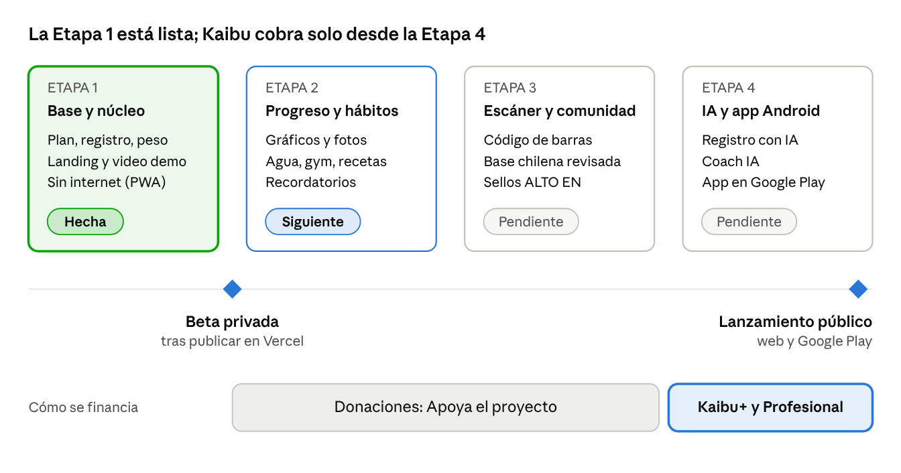

# Kaibu · Especificación de Requisitos de Software (SRS)

28 de octubre de 2026 · Sxnr

> Copia en el repositorio del documento vivo. La versión editable y con diagramas interactivos está en Claude Docs.

Kaibu es una app chilena de nutrición y progreso físico, para web y Android con la misma cuenta, que hace gratis lo básico: el plan de calorías, su explicación y el registro diario. Cobra solo por lo avanzado, como la inteligencia artificial. La Etapa 1 está construida y funcionando; este documento especifica el producto completo y su modelo de retorno.

## 1. Introducción

Este SRS describe qué debe hacer Kaibu, para quién y con qué calidad, desde la Etapa 1 (lista) hasta la Etapa 4. Sirve a dos lectores: a quien evalúa el proyecto (socios, inversionistas, nutricionistas) y a quien lo construye.

**Alcance.** Kaibu calcula un plan nutricional personal, registra comidas y peso, y muestra el progreso real del usuario. Funciona en el navegador (PC y celular, instalable como app) y como app Android, con la misma cuenta y los mismos datos sincronizados. Funciona sin conexión.

**Fuera de alcance.** Kaibu no diagnostica ni trata enfermedades, no reemplaza a un nutricionista ni a un médico, y no vende planes de dieta cerrados.

**Cómo leer los requisitos.** Cada requisito tiene un código (RF = funcional, RNF = no funcional), la etapa en que se construye, su estado actual (Hecho / Pendiente) y su nivel de acceso: **Gratis** (para siempre), **Kaibu+** (membresía) o **Profesional** (plan para nutricionistas y gimnasios).

**Documentos base.** El documento de requisitos del dueño (secciones 1 a 16), el código del repositorio [Sxnr/Kaibu](https://github.com/Sxnr/Kaibu) y las fuentes de la sección 13.

## 2. Problema y propuesta de valor

Comer equilibrado parte de un cálculo público (la fórmula Mifflin-St Jeor, de 1990), y las apps populares lo esconden detrás de suscripciones, sin explicar de dónde sale cada número. Kaibu entrega ese cálculo gratis, explicado y adaptado a Chile.

**El problema, en tres partes:**

1. **Lo básico se cobra.** Las funciones esenciales (plan, macros, registro cómodo) suelen quedar tras un pago; MyFitnessPal Premium se reporta en torno a US$ 79,99 al año.
2. **Los números no se explican.** El usuario recibe una meta de calorías sin saber por qué, y no aprende a ajustarla.
3. **No está pensado para Chile.** Faltan alimentos locales (marraqueta, hallulla, once), el formato chileno (coma decimal, punto de miles) y los sellos "ALTO EN".

**Propuesta de valor.**

- **Gratis lo básico, para siempre:** plan, explicación de cada número, registro de comidas y peso, progreso y exportación de datos.
- **Cada número explicado:** la app muestra la fórmula, el factor de actividad y el déficit que llevan a la meta.
- **Hecha en Chile:** 115 alimentos chilenos con su fuente (INTA, U. de Chile) y comidas como desayuno, almuerzo, once y cena.
- **Registrar en menos de 10 segundos:** recientes, favoritos, copiar ayer y agregado rápido.
- **Funciona sin internet** y sincroniza al volver la señal.
- **Privacidad por diseño:** sin publicidad, sin venta de datos, consentimiento explícito para datos de salud.

**Lo que se cobra** es lo que tiene un costo real por uso o es claramente avanzado, como la inteligencia artificial (sección 10).

## 3. Usuarios y perfiles

Kaibu sirve a adultos en Chile que quieren bajar grasa, mantenerse o ganar músculo, y a los profesionales que los acompañan.

| Perfil | Qué necesita | Qué usa | Acceso |
| --- | --- | --- | --- |
| Persona que parte de cero | Saber cuánto comer y por qué, sin pagar | Cuestionario, Tu plan, Hoy, Agregar | Gratis |
| Persona constante (gym, deporte) | Registrar rápido, ver su avance real, progresar en el gym | Progreso, racha, gym, suplementos | Gratis |
| Usuario que quiere comodidad extra | Registrar por voz o foto, recibir consejos | Registro con IA, Coach IA | Kaibu+ |
| Nutricionista | Seguir a sus pacientes entre consultas | Panel de pacientes (con su consentimiento) | Profesional |
| Gimnasio o entrenador | Acompañar la nutrición de sus alumnos | Panel de alumnos, indicadores del grupo | Profesional |

**Edad mínima:** 18 años, o de 14 a 17 con autorización de un adulto responsable (a definir en el documento legal).

**Idioma y formato:** español de Chile, coma decimal, punto de miles, fechas en español y semana de lunes a domingo.

## 4. Hoja de ruta

La Etapa 1 está construida y probada; la Etapa 2 empieza con la aprobación del dueño. Todo lo gratis llega en las Etapas 1 a 3; los planes de pago, con la IA de la Etapa 4.



Las donaciones financian el arranque desde la beta; Kaibu+ y el plan Profesional llegan junto con la IA.

## 5. Requisitos funcionales

De 46 requisitos, 19 están hechos y 3 a medio camino; 41 son gratis para siempre. Solo la IA de registro, el Coach y la membresía son Kaibu+, y el panel para profesionales es el plan Profesional.

### 5.1 Cuenta, inicio y plan

| Código | Requisito | Etapa | Estado | Acceso |
| --- | --- | --- | --- | --- |
| RF-01 | Landing web pública que lleva a crear cuenta | 1 | Hecho | Gratis |
| RF-02 | Bienvenida de 3 a 4 pantallas con botón Saltar | 1 | Hecho | Gratis |
| RF-03 | Registro con email y contraseña, y con Google (vincula cuentas del mismo correo) | 1 | Hecho | Gratis |
| RF-04 | Recuperar contraseña | 1 | Hecho | Gratis |
| RF-05 | Consentimientos separados y sin marcar: Términos y datos de salud | 1 | Hecho | Gratis |
| RF-06 | Cuestionario de una pregunta por pantalla con barra de avance | 1 | Hecho | Gratis |
| RF-07 | "Tu plan": kcal, macros y reparto por comida, explicando cada número, con ajuste manual | 1 | Hecho | Gratis |
| RF-08 | Mi plan: mantenimiento, meta, rango, macros, reparto, agua y fase, con la explicación de cada valor | 1 | Hecho | Gratis |
| RF-09 | Ajuste semanal sugerido que el usuario acepta o rechaza | 2 | Cálculo hecho, pantalla pendiente | Gratis |
| RF-10 | Avisos de seguridad respetuosos (meta muy baja o ritmo muy rápido) | 2 | Cálculo hecho, pantalla pendiente | Gratis |

### 5.2 Registro diario

| Código | Requisito | Etapa | Estado | Acceso |
| --- | --- | --- | --- | --- |
| RF-11 | Hoy: tira semanal con estado por día, kcal restantes, rango ±10 % y barras de macros | 1 | Hecho | Gratis |
| RF-12 | Comidas del día (3 o 4 más colaciones) con total y botón "+" | 1 | Hecho | Gratis |
| RF-13 | Racha de días cumplidos | 1 | Hecho | Gratis |
| RF-14 | Buscar en catálogo, mis alimentos, recientes y favoritos | 1 | Hecho | Gratis |
| RF-15 | Cantidad en gramos, porciones o unidades, con cálculo automático | 1 | Hecho | Gratis |
| RF-16 | Agregado rápido (solo kcal y proteína) y copiar comida o día de ayer | 1 | Hecho | Gratis |
| RF-17 | Mis alimentos: crear, editar y borrar alimentos propios | 1 | Hecho | Gratis |
| RF-18 | Todo se edita o borra, con aviso inferior y "Deshacer" | 1 | Hecho | Gratis |
| RF-19 | Terminar día y celebraciones breves (racha, –1 kg, meta) | 2 | Pendiente | Gratis |
| RF-20 | Agua, suplementos y notas del día | 2 | Pendiente | Gratis |
| RF-21 | Personalizar la vista de Hoy (mostrar, ocultar y ordenar tarjetas) | 2 | Pendiente | Gratis |

### 5.3 Peso y progreso

| Código | Requisito | Etapa | Estado | Acceso |
| --- | --- | --- | --- | --- |
| RF-22 | Registro de peso con fecha, promedio móvil de 7 días | 1 | Hecho | Gratis |
| RF-23 | Tarjeta de fase: avance, % logrado y fecha estimada | 1 | Hecho | Gratis |
| RF-24 | Ritmo real comparado con el planeado | 1 | Hecho | Gratis |
| RF-25 | Gráfico de peso (diario y promedio) con 2 sem / 1 mes / 3 meses / todo | 2 | Pendiente | Gratis |
| RF-26 | Score semanal y gráficos de kcal y macros | 2 | Pendiente | Gratis |
| RF-27 | Fotos de progreso privadas, línea de tiempo y comparación antes/ahora | 2 | Pendiente | Gratis |
| RF-28 | Medidas corporales opcionales | 2 | Pendiente | Gratis |

### 5.4 Hábitos, gym y herramientas

| Código | Requisito | Etapa | Estado | Acceso |
| --- | --- | --- | --- | --- |
| RF-29 | Recordatorios con hora, días y horario de silencio | 2 | Pendiente | Gratis |
| RF-30 | Gym: rutina propia, series y aviso de progresión | 2 | Pendiente | Gratis |
| RF-31 | Recetas y lista de compras | 2 | Pendiente | Gratis |
| RF-32 | Ayuno opcional (apagado por defecto) | 2 | Pendiente | Gratis |
| RF-33 | Exportar mis datos (JSON y CSV) y borrar cuenta con todos sus datos | 2 | Pendiente | Gratis |
| RF-34 | Informe PDF de progreso | 2 | Pendiente | Gratis |
| RF-35 | Documentos legales y pantalla de licencias | 2 | Borradores hechos | Gratis |

### 5.5 Escáner y comunidad

| Código | Requisito | Etapa | Estado | Acceso |
| --- | --- | --- | --- | --- |
| RF-36 | Escáner de código de barras (web y Android) | 3 | Pendiente | Gratis |
| RF-37 | Productos de Open Food Facts | 3 | Pendiente | Gratis |
| RF-38 | Base comunitaria chilena: aportes, verificación, reportes y sellos "ALTO EN" | 3 | Pendiente | Gratis |
| RF-39 | Lectura de etiqueta nutricional con IA al aportar un producto | 3 | Pendiente | Gratis, con límite diario |

### 5.6 Inteligencia artificial y app nativa

| Código | Requisito | Etapa | Estado | Acceso |
| --- | --- | --- | --- | --- |
| RF-40 | Registro por texto o voz ("2 huevos y una marraqueta con palta") | 4 | Pendiente | Kaibu+ |
| RF-41 | Registro por foto del plato | 4 | Pendiente | Kaibu+ |
| RF-42 | Coach IA que conoce solo los registros del usuario | 4 | Pendiente | Kaibu+ |
| RF-43 | App Android: Health Connect (pasos), widget y notificaciones nativas | 4 | Pendiente | Gratis |

### 5.7 Monetización (propuesta, por confirmar)

| Código | Requisito | Etapa | Estado | Acceso |
| --- | --- | --- | --- | --- |
| RF-44 | Membresía Kaibu+ mensual o anual, con prueba gratis y cancelación en un toque | 4 | Propuesta | Kaibu+ |
| RF-45 | Plan Profesional: el usuario invita a su nutricionista o gimnasio y puede revocar el acceso cuando quiera | 4 | Propuesta | Profesional |
| RF-46 | Botón "Apoya el proyecto" (donaciones) en la web | 2 | Propuesta | Gratis |

## 6. Reglas de cálculo

Todos los cálculos son funciones puras con pruebas automáticas (103 pruebas en verde) y son gratis: son matemática pública explicada. Ejemplo real de la app: mujer de 31 años, 165 cm, 70,5 kg, actividad ligera, bajar 0,5 kg por semana.

**Metabolismo basal (Mifflin-St Jeor).** Hombre suma 5; mujer resta 161.

```latex
BMR = 10 \cdot peso_{kg} + 6{,}25 \cdot estatura_{cm} - 5 \cdot edad + s, \quad s = +5 \ (\text{hombre}),\ -161 \ (\text{mujer})
```

Ejemplo: 10 × 70,5 + 6,25 × 165 − 5 × 31 − 161 = 1.420 kcal.

**Mantenimiento.** Basal × factor de actividad (sedentario 1,2 · ligero 1,375 · moderado 1,55 · alto 1,725 · muy alto 1,9), que combina actividad diaria y días de entrenamiento. Ejemplo: 1.420 × 1,375 = 1.953 kcal.

**Meta diaria.** Mantenimiento ± el ajuste por velocidad (1 kg ≈ 7.700 kcal):

```latex
Meta = Mantenimiento \pm \frac{velocidad_{kg/sem} \cdot 7700}{7}
```

Ejemplo: 1.953 − 550 = 1.403 kcal. Velocidades: déficit 0,25 / 0,5 / 0,75 kg por semana; volumen 0,1 / 0,2 / 0,3.

| Valor | Regla |
| --- | --- |
| Rango aceptable | Meta ± 10 %; el día dentro del rango cuenta como cumplido |
| Proteína | Déficit 2,0 g/kg; mantener o volumen 1,8 g/kg (editable 1,6–2,4) |
| Grasas | 0,8 g/kg (mínimo 0,6 g/kg) |
| Carbohidratos | Las kcal restantes (proteína y carbos 4 kcal/g, grasas 9 kcal/g) |
| Reparto por comida | Porcentajes editables (ej. 4 comidas: 25 / 35 / 15 / 25) |
| Agua | 35 ml por kg de peso, editable |
| Peso de referencia | Promedio móvil de 7 días |
| Ritmo real | Diferencia entre promedios semanales |
| Fecha estimada | Según ritmo real; con menos de 2 semanas de datos, según el planeado |
| Ajuste semanal | Si baja menos de la mitad de lo planeado 2 semanas: sugerir −150 kcal; si baja más de 1 % del peso por semana: +150 a +200 kcal |
| Límites de seguridad | Meta bajo 1.500 kcal (hombres) o 1.200 kcal (mujeres), o ritmo sobre 1 % semanal: un aviso respetuoso, el usuario decide |
| Cambio de fase | Al llegar a la meta, proponer mantener o volumen, subiendo +100 a +150 kcal por semana |
| Coherencia de alimentos | kcal ≈ 4·P + 4·C + 9·G con margen ±15 %; valores imposibles se rechazan |

## 7. Requisitos de datos

Cada usuario solo puede leer y escribir sus propios datos (Row Level Security en todas las tablas); el catálogo de alimentos es lo único compartido. La app no trae datos inventados: todo parte vacío, salvo el catálogo.

| Entidad | Qué guarda | Estado |
| --- | --- | --- |
| profiles | Datos físicos, objetivo, fase, comidas del día, tema y preferencias | Hecho |
| consents | Aceptación de Términos y de datos de salud, con fecha y versión | Hecho |
| weights | Peso por fecha (uno por día) | Hecho |
| food_logs | Cada alimento registrado: fecha, comida, cantidad, kcal y macros | Hecho |
| user_foods | Alimentos personales (privados) | Hecho |
| favorites | Favoritos por usuario | Hecho |
| foods_catalog | 115 alimentos chilenos con valores por 100 g, porción típica y fuente | Hecho |
| Fotos, medidas, agua, suplementos, notas, gym, recetas, recordatorios | Hábitos y progreso de la Etapa 2 | Pendiente |
| Productos comunitarios y reportes | Base chilena por código de barras, con estado "por verificar" o "verificado" | Pendiente |
| Suscripciones y vínculos profesionales | Plan del usuario y permisos que otorga a su nutricionista | Pendiente (propuesta) |

**Reglas de datos.**

- **Borrado suave:** se marca con fecha de borrado (`deletedAt`) para poder deshacer y sincronizar.
- **Sin conexión:** todo se guarda primero en el dispositivo (IndexedDB) y una cola sube los cambios a Supabase al volver la señal.
- **Fotos:** en un almacenamiento privado, con enlaces temporales; nunca visibles para otros ni enviadas a la IA.
- **Al cerrar sesión:** los datos de salud se borran del dispositivo.
- **Validación:** en la app (Zod) y en la base de datos (reglas CHECK).

## 8. Requisitos no funcionales

La app debe verse y funcionar bien en celular (desde 360 px) y PC (hasta 1920 px), con y sin internet, accesible y protegiendo datos de salud como datos sensibles.

| Código | Requisito | Cómo se verifica | Estado |
| --- | --- | --- | --- |
| RNF-01 Rendimiento | Lighthouse 90+ en rendimiento, accesibilidad, buenas prácticas y PWA | Medición Lighthouse (hoy: móvil 89 en rendimiento, PC 100 en todo) | Casi |
| RNF-02 Sin conexión | Registrar comidas sin internet y sincronizar después | Prueba automática sin red | Hecho |
| RNF-03 Adaptable | Navegación inferior en celular, menú lateral en PC; sin scroll horizontal | Pruebas en 390 px y 1440 px | Hecho |
| RNF-04 Accesibilidad | WCAG 2.2 AA: contraste 4,5:1, áreas táctiles de 44 px, teclado, lector de pantalla, "reducir movimiento" | Revisión automática con axe en cada pantalla | Hecho |
| RNF-05 Usabilidad | Registrar una comida común en menos de 10 segundos; sin ventanas que interrumpan | Pruebas de flujo | Hecho |
| RNF-06 Seguridad | RLS en todas las tablas, claves secretas solo en el servidor, encabezados de seguridad (CSP), HTTPS | Prueba SQL de RLS y prueba de encabezados | Hecho |
| RNF-07 Privacidad | Consentimiento explícito para datos de salud; ver, descargar, corregir y borrar todos los datos | Revisión legal y flujo de borrado | Parcial |
| RNF-08 Límites de uso | Límite de solicitudes en escáner, aportes e IA | Pruebas de límite | Pendiente |
| RNF-09 Calidad | TypeScript estricto, ESLint con accesibilidad, pruebas automáticas de cálculos y pantallas | 103 pruebas unitarias y 20 de recorrido en verde | Hecho |
| RNF-10 Monitoreo | Errores en producción con Sentry, sin datos personales ni de salud | Panel de Sentry | Pendiente |
| RNF-11 Respaldo | Copia de seguridad automática de la base de datos | Configuración del proveedor | Pendiente |
| RNF-12 Formato chileno | Coma decimal, punto de miles, fechas en español, semana de lunes a domingo | Pruebas unitarias de formato | Hecho |

**Ley chilena.** Peso, alimentación y fotos corporales son datos sensibles de salud bajo la Ley 21.719, prevista para regir el 1 de diciembre de 2026; hay un proyecto que propone postergarla a diciembre de 2027 (por confirmar). Kaibu aplica sus exigencias desde ya: consentimiento explícito, finalidad clara, mínimos datos y derechos de acceso, rectificación, supresión y portabilidad.

## 9. Interfaces y tecnología

Una sola app web (React) sirve para PC, celular y Android; guarda todo primero en el dispositivo y lo sincroniza con Supabase. Las claves secretas, como las de la IA, viven solo en el servidor.


| Capa | Tecnología | Por qué |
| --- | --- | --- |
| Interfaz | React 19, Vite, TypeScript estricto, Tailwind, componentes accesibles (Radix), Motion | Una sola base de código para todas las pantallas |
| Sin conexión | Dexie (IndexedDB) y PWA (Workbox) | Registrar sin señal y sincronizar después |
| Servidor | Supabase: Auth, Postgres con RLS, Storage y Edge Functions | Plan gratis al inicio, seguridad por usuario en la base de datos |
| Web | Vercel, con encabezados de seguridad (CSP) y HTTPS | Publicación gratis mientras no se cobre |
| Android (Etapa 4) | Capacitor: escáner ML Kit, cámara, notificaciones, Health Connect | Reutiliza la misma app web |
| Datos externos | Open Food Facts (licencia ODbL) | Productos envasados con código de barras |
| IA (Etapa 4) | Gemini o Claude, solo desde Edge Functions | La clave nunca queda en el celular |
| Calidad | Vitest, Playwright con axe, ESLint con accesibilidad, Sentry | Que nada se rompa en web ni en móvil |

**Material de presentación listo:** landing web y video demo 3D (horizontal de 60 s y vertical de 30 s) en la carpeta `video/entregas` del repositorio.

## 10. Modelo de negocio

Kaibu es freemium con una regla fija: **lo básico es gratis para siempre y se cobra solo lo avanzado o lo que cuesta dinero en cada uso.** Los ingresos vienen de tres fuentes, en este orden: donaciones al inicio, membresía Kaibu+ y plan Profesional.

**La regla para decidir qué se cobra.** Algo es gratis si es un cálculo, una fórmula o un registro que solo hace más simple lo que el usuario podría hacer con una calculadora. Se cobra si usa inteligencia artificial (cada uso tiene un costo) o si es una herramienta de trabajo para un profesional. Los derechos sobre los propios datos (descargar, borrar) son siempre gratis porque la ley los exige.

| | Gratis (siempre) | Kaibu+ (membresía) | Profesional |
| --- | --- | --- | --- |
| Para quién | Toda persona | Quien quiere más comodidad | Nutricionistas, entrenadores y gimnasios |
| Qué incluye | Plan y explicación de cada número, registro, catálogo chileno, peso y progreso con gráficos, fotos, hábitos, gym, recetas, recordatorios, escáner, sin internet, exportar y borrar datos | Todo lo gratis + registro por texto, voz y foto del plato, Coach IA | Panel con los pacientes o alumnos que lo autorizan, resúmenes semanales y alertas |
| Precio propuesto (IVA incluido) | $0 | $2.990 al mes o $24.990 al año | $14.990 al mes por profesional (hasta 40 personas); gimnasios $49.990 al mes por sede |
| Cuándo llega | Etapas 1 a 3 | Etapa 4 | Después de la Etapa 4 |

**Por qué esos precios.**

- **Kaibu+ a $24.990 al año** cuesta cerca de un tercio de MyFitnessPal Premium (unos US$ 79,99 al año, cerca de $76.000) y menos que Yazio PRO (unos US$ 47,90 al año en EE. UU.). Es accesible en Chile y sigue cubriendo con holgura el costo de la IA.
- **Profesional a $14.990 al mes** equivale a menos de media consulta: una consulta con nutricionista en Chile cuesta en general entre $20.000 y $40.000. Si el panel le ahorra tiempo o le retiene un paciente, se paga solo.
- **Donaciones al inicio** ("Apoya el proyecto", con Ko-fi o Buy Me a Coffee) cubren los costos mínimos mientras no hay funciones de pago. No dan acceso a nada extra.

**Lo que Kaibu nunca hará:** mostrar publicidad, vender datos, cobrar por la fórmula o el plan básico, ni compartir datos con un profesional sin el permiso explícito del usuario (revocable en cualquier momento).

## 11. Precios, costos y punto de equilibrio

Con unos **35 suscriptores Kaibu+** (o 5 profesionales) Kaibu cubre su costo técnico mensual de unos $50.000. Con una conversión típica de apps freemium (2 % a 5 %), eso son entre 700 y 1.750 usuarios activos. Todas las cifras son estimaciones en pesos chilenos, con US$ 1 ≈ $950, y deben validarse antes de invertir.

### 11.1 Cuánto queda de cada suscripción

| Concepto (por usuario al mes) | Kaibu+ mensual | Kaibu+ anual (÷12) | Profesional |
| --- | --- | --- | --- |
| Precio con IVA | $2.990 | $2.083 | $14.990 |
| Sin IVA (19 %) | $2.513 | $1.750 | $12.597 |
| Menos comisión de pago | $2.136 (Google Play 15 %) | $1.488 (Google Play 15 %) | $12.150 (pago web, ~3,5 %) |
| Menos costo de IA | $1.836 | $1.188 | $12.150 |

Si el 60 % elige el plan anual, cada suscriptor Kaibu+ deja en promedio **$1.747 al mes**, y **$1.447** después de pagar la IA.

**Costo de la IA.** Con Gemini 2.5 Flash (US$ 0,30 por millón de tokens de entrada y US$ 2,50 de salida), un registro por texto cuesta cerca de US$ 0,0012. Un usuario intenso (150 registros, 20 consultas al Coach y 30 fotos al mes) cuesta unos US$ 0,30, es decir unos $300. Un límite diario de usos mantiene ese tope.

### 11.2 Costos fijos de operar

| Etapa | Servicios | Costo mensual aproximado |
| --- | --- | --- |
| Lanzamiento, sin cobros (hasta 50.000 usuarios activos) | Supabase gratis, Vercel Hobby, Sentry gratis, dominio | ~$1.000 (más US$ 25 una vez por la cuenta de Google Play) |
| Con cobros (hasta 100.000 usuarios activos) | Supabase Pro US$ 25, Vercel Pro US$ 20 por persona, dominio, margen | ~$50.000 |
| Crecimiento | Supabase con más capacidad de cómputo, Sentry pago | ~$80.000 a $240.000 |

Vercel Hobby no permite uso comercial, por eso al empezar a cobrar se pasa a Vercel Pro. No incluye sueldos, marketing, abogado, contador ni impuestos a la renta.

### 11.3 Escenarios a 12 meses (ilustrativos)

| Escenario | Usuarios activos | Conversión | Kaibu+ | Profesionales | Ingreso neto al mes | Costos al mes | Resultado al mes |
| --- | --- | --- | --- | --- | --- | --- | --- |
| Conservador | 3.000 | 2 % | 60 | 3 | $141.000 | $68.000 | +$73.000 |
| Base | 15.000 | 3 % | 450 | 20 | $1.029.000 | $215.000 | +$814.000 |
| Optimista | 50.000 | 5 % | 2.500 | 80 | $5.340.000 | $990.000 | +$4.350.000 |

Los costos incluyen infraestructura e IA. Ninguna cifra de usuarios es un dato: son supuestos para mostrar cómo escala el modelo.

### 11.4 Cuándo es un buen negocio

1. **Se sostiene solo** con unos 35 suscriptores o 5 profesionales: cubre servidores y dominio.
2. **Paga un sueldo** de $1.000.000 al mes con unos 730 suscriptores (cerca de 24.000 usuarios activos al 3 %), o una mezcla como 400 suscriptores y 40 profesionales.
3. **Es invertible** cuando la retención y la conversión reales de una beta confirman estos supuestos. Ese es el dato que un inversionista pedirá primero.

**Qué medir desde la beta:** usuarios activos semanales, retención a 7 y 30 días (el promedio de apps de salud ronda el 18 % al día 7), conversión a Kaibu+, cancelaciones mensuales y costo de IA por usuario.

## 12. Riesgos y supuestos

El mayor riesgo no es técnico sino de adopción: que la gente use Kaibu de forma constante y que una parte pague por lo avanzado. Una beta privada es la forma más barata de medirlo.

| Riesgo | Impacto | Mitigación |
| --- | --- | --- |
| Poca retención (la gente deja de registrar) | Alto | Registro en menos de 10 segundos, recordatorios útiles, racha y celebraciones sin presión; medir retención desde la beta |
| Conversión a Kaibu+ menor al 2 % | Alto | Prueba gratis de la IA, plan Profesional como segunda fuente, donaciones al inicio |
| Costo de IA mayor al estimado | Medio | Límite diario de usos, modelo económico (Gemini Flash), revisar precios del proveedor cada trimestre |
| Cambios en la ley de datos (Ley 21.719 y su posible postergación) | Medio | Cumplir desde ya; revisión de un abogado antes del lanzamiento |
| Comisiones de Google Play | Medio | Ofrecer también el pago web (Flow o Mercado Pago) donde las reglas lo permitan |
| Datos erróneos en la base comunitaria | Medio | Validación automática, verificación por 2 o 3 usuarios, botón reportar y límite de aportes |
| Dependencia de servicios gratuitos (Supabase, Vercel) | Bajo | Pasar a sus planes pagos cuando haya ingresos; los datos se pueden exportar |
| Competencia con marcas grandes | Medio | Diferenciarse en lo local, lo gratuito y lo explicado; no competir en precio de la IA |

**Supuestos de este documento:** tipo de cambio US$ 1 ≈ $950; 60 % de suscriptores en plan anual; IVA de 19 % incluido en los precios; comisión de Google Play de 15 % en suscripciones; precios de la competencia tomados de fuentes secundarias de 2026.

## 13. Glosario y fuentes

| Término | Significado |
| --- | --- |
| SRS | Especificación de Requisitos de Software: qué debe hacer el sistema y con qué calidad |
| Freemium | Modelo con un plan gratis completo y planes pagos opcionales |
| Kaibu+ | Membresía de pago con las funciones de IA |
| Usuarios activos (MAU) | Personas que usan la app al menos una vez en el mes |
| Conversión | Porcentaje de usuarios gratis que pasan a un plan pago |
| Retención | Porcentaje de usuarios que siguen usando la app tras 7 o 30 días |
| PWA | App web instalable que funciona sin conexión |
| RLS | Row Level Security: regla de la base de datos que deja a cada usuario ver solo lo suyo |
| Kcal, macros | Calorías y macronutrientes (proteína, carbohidratos y grasas) |
| Mifflin-St Jeor | Fórmula pública (1990) para estimar el gasto en reposo |

**Fuentes consultadas** (precios y normas de terceros; revisar antes de decidir):

- [Supabase — precios oficiales](https://supabase.com/pricing): Pro US$ 25 al mes con 100.000 usuarios activos; plan gratis con 50.000.
- [Vercel — plan Pro](https://vercel.com/docs/plans/pro-plan): US$ 20 por persona al mes.
- [Google Play — tarifas de servicio](https://support.google.com/googleplay/android-developer/answer/16954621) y [análisis de Adapty](https://adapty.io/blog/google-play-billing-changes-subscriptions-fees): 15 % efectivo en suscripciones.
- [Precios de Gemini 2.5 Flash (MorphLLM)](https://www.morphllm.com/gemini-api-pricing): US$ 0,30 y US$ 2,50 por millón de tokens.
- [MyFitnessPal Premium 2026 (Nutrola)](https://nutrola.app/en/blog/how-much-does-myfitnesspal-cost-now-2026): unos US$ 79,99 al año.
- [Yazio PRO 2026 (NutriScan)](https://nutriscan.app/blog/posts/yazio-pricing-2026-free-vs-pro-what-pro-unlocks-33b26f8fc7): unos US$ 47,90 al año en EE. UU.
- [Costo de un nutricionista en Chile (Cronoshare)](https://www.cronoshare.cl/cuanto-cuesta/nutricionista): entre $25.000 y $40.000 por consulta.
- [Benchmarks de apps de salud (Adapty)](https://adapty.io/blog/health-fitness-app-subscription-benchmarks/) y [conversión freemium](https://adapty.io/blog/freemium-to-premium-conversion-techniques): 2 % a 5 % de conversión.
- [Ley 21.719 (YourDevs)](https://www.yourdevs.net/blog/ley-21719-proteccion-datos-chile) y [posible postergación (Ecosistema Startup)](https://ecosistemastartup.com/?p=104145).
- [Dólar en Chile, septiembre de 2026 (Portal Innova)](https://portalinnova.cl/?p=252654): cerca de $959.

No se encontró un precio público confirmado de Fitia Premium en Chile; conviene revisarlo en la tienda de apps.
